# 0006 Esquema de base de datos final

Fecha: 2026-11-04, revisión 3 del 2026-11-05 · Tareas: 1.8, 1.9 (`docs/tareas/1.9-esquema-final.md`), 5.1, 5.4 y 5.5 · Estado: **aceptada por el fundador** (2026-11-07) y aplicada en la tarea 1.9 (migraciones 2 a 8); las migraciones 9, 10 y 11 llegan en las tareas 5.4, 5.5 y 5.1. Siguen abiertas las tres decisiones de la sección 6.

> **Numeración:** comparte el número 0006 con `0006-correo-unico-canal.md`; no se renombró ninguna (tarea 1.9). "Decisión 0006" sin más se refiere a este documento.
>
> **Nota de la 1.9:** el SQL de A.1 en este anexo difiere del que se aplicó en la tarea 1.8 (`20261105025014_email_as_only_channel.sql`) en nombres de constraints e índices (por ejemplo, `customers_barbershop_id_email_key` es una restricción única y no un índice parcial). Ninguna de las migraciones 2 a 11 depende de esos nombres, así que manda la migración aplicada.

Reemplaza, en lo que toque, a las decisiones 0001 (puntos 2, 4, 7, 9 y 13), 0002 (tabla de permisos y punto 4) y 0004 (punto 1). Lo que este documento no menciona sigue igual.

> **Revisión 3, 2026-11-05: decisiones finales del fundador.** Cambios frente a la revisión 2:
>
> 1. **Reactivar** (función 22) solo levanta la suspensión manual de una barbería cuya vigencia, que sale solo de los pagos, todavía cubre hoy o los 5 días de gracia. No toca fechas. Si la vigencia se acabó, rechaza y pide registrar el pago, porque registrar el pago ya reactiva. Se quita la propuesta de `subscription_extensions`.
> 2. **Prueba gratis por empresa:** las sedes que crea un dueño comparten la prueba de su primera barbería. Una sede creada cuando esa prueba ya venció nace en la fase `awaiting_first_payment`: se puede configurar, pero no recibe citas hasta su primer pago. Cada sede paga su suscripción (interpretación a confirmar, sección 6).
> 3. **El abuso de pruebas con muchas sedes** queda fuera de alcance.
> 4. **Un solo plan:** 25.000 COP por sede al mes, con hasta 5 barberos. Ese número es informativo: nunca se bloquea registrar más. Se eliminan los periodos trimestral y anual: cada pago cubre un mes.
> 5. **Suspensión:** el dueño y el barbero (por su link) pueden marcar "atendida" o "no asistió", y el cliente (por su link) puede cancelar su cita. Nada más, y lo exige la base de datos para todos los actores.
> 6. **Barbero desactivado:** su agenda se cierra hacia adelante (sin citas nuevas o movidas ni bloqueos nuevos). Con su link sigue gestionando las citas que ya tenía: las cierra o las cancela. Su link no se desactiva por eso. El dueño puede reasignarlas o cancelarlas.
> 7. **Varios servicios por cita**, cambio posterior que revierte "combos como servicios": tabla `appointment_services`. La cita sigue siendo un solo bloque con un solo barbero, la base de datos garantiza los totales y el barbero debe ofrecer todos los servicios. Se elimina `appointments.service_id`.
>
> El plan pasa a 11 migraciones y la validación se repitió completa.

## Contexto

La fase 1 dejó 13 tablas, RLS en lista blanca, citas sin cruces y registro atómico: 6 migraciones, hasta el commit `0235b9e`. Antes de la fase 2 hay que fijar el esquema final, mientras no haya datos de producción (el proyecto `barberias-prod` se crea en la tarea 6.4). Las fuentes son tres:

1. **La tarea 1.8, ya aprobada:** el correo es el único canal de avisos.
   - `customers` gana `email`, en minúsculas y único por barbería cuando exista; `phone` pasa a ser opcional y no único.
   - `barbers` gana `email` y pierde `phone`; `whatsapp_notifications` pasa a ser `email_notifications`.
   - `notifications` pierde `channel`.
   - `barbershops.whatsapp_phone` se queda, pero solo como contacto.
2. **La revisión de un ingeniero de datos**, en 8 puntos.
3. **Las decisiones del fundador:** revisiones 2 y 3.

**Dimensionamiento:** 1.000 barberías × ~4 barberos × ~10 citas al día ≈ 40.000 citas al día, unos 15 millones al año. Los clientes reservan sin cuenta. Los barberos entran con un link, del que solo se guarda el SHA-256. Un super admin registra a mano los pagos que llegan por transferencia; no hay pagos en línea.

**Regla de prioridad:** si la spec contradice a la revisión, gana la spec. Si el fundador decidió, gana el fundador y se señala la diferencia con la spec; la tarea 1.9 actualiza la spec en su primer paso. Lo que nadie respondió no se inventa: queda en la sección 6.

**Cómo se validó (revisión 3).** Todo se corrió en PostgreSQL 15.5, con sustitutos mínimos de Supabase: `auth.uid()`, los roles `anon`, `authenticated` y `service_role`, y `cron.schedule`.

- Se aplicaron las 6 migraciones actuales y las 11 nuevas de la sección 5, en orden y sobre una base con datos. La base incluía una cita y un pago previos, para probar que se crea una línea por cita existente y que se rellena `trial_ends_on`.
- El SQL consolidado de la sección 4 produce **el mismo catálogo** que las migraciones: columnas, constraints, índices, políticas, permisos por tabla y por columna, funciones comparadas por el hash de su código, triggers con sus atributos de diferido, y enums. Solo difieren los permisos `EXECUTE` de tres funciones auxiliares de la 1.1, y es inocuo.
- Las **86 verificaciones de comportamiento** (52 operaciones que deben pasar y 34 que deben rechazarse) dan exactamente el mismo resultado en las dos bases. Cubren:
  - aislamiento entre barberías, cadenas y `create_barbershop` con la prueba gratis compartida;
  - correo obligatorio en la web y barbero inactivo (citas, bloqueos y su link);
  - varios servicios: totales, tope, repetidos, servicio inactivo, barbero que no ofrece, cambio de servicios, reprogramación y cruces sobre el rango total;
  - el plan único, los pagos, la anulación y el recálculo, y el 31 de enero;
  - la fase `awaiting_first_payment`, la suspensión por actor, Reactivar y la gracia del día 5 frente al día 6.
- También se repitió la regresión de la primera ronda: correo único, turnos que se cruzan, cadenas y purga de la cola.
- Los bloques SQL de este documento se extraen del propio archivo y se aplican así para validarlos.

En CI hay que repetir todo contra Supabase 17 real.

## Decisiones de negocio tomadas

- Roles en el MVP: solo dueño (`owner`) y super admin. Administrador y recepcionista quedan para la fase 2, sin permisos definidos.
- Multi-sede desde la primera versión: el dueño crea otra sede desde su misma cuenta.
- Prueba gratis por empresa: las sedes comparten la prueba de la primera barbería de la cuenta. Una sede creada después de que la prueba venció no recibe citas hasta su primer pago.
- Un solo plan: 25.000 COP por sede al mes, con hasta 5 barberos (informativo). Cada pago cubre un mes.
- No hay límite de barberos: se registran los que hagan falta. Un barbero se da de baja desactivándolo, sin borrarlo.
- Barbero desactivado: no recibe citas nuevas, movidas ni bloqueos. Gestiona por su link las citas que ya tenía (atendida, no asistió, cancelar), y el dueño puede reasignarlas o cancelarlas.
- **El cliente puede reservar varios servicios en una sola cita.**
- Correo obligatorio en la reserva web y opcional en la cita manual. El cliente que vuelve se reconoce por su correo.
- Pagos solo por transferencia, registrados a mano por el super admin. No se editan ni se borran; un registro equivocado se anula con rastro.
- La vigencia sale solo de los pagos (y de la prueba). Un pago del 31 de enero vence el 28 de febrero.
- Reactivar levanta la suspensión manual si la vigencia sigue cubriendo; no extiende fechas.
- Suspensión: el dueño y el barbero pueden marcar atendida o no asistió, y el cliente puede cancelar. Nada más.
- La cola de avisos se guarda 90 días.
- El abuso de pruebas con muchas sedes queda fuera de alcance por ahora.

## Decisión

| # | Punto | Decisión | Por qué |
| --- | --- | --- | --- |
| 1 | Multi-sede y roles | **`memberships`** (cuenta, barbería, rol). **Roles: `owner` y super admin** (`profiles.is_super_admin`), con un dueño por barbería. **`create_barbershop()`** crea sedes desde la primera versión. RLS: `member_barbershop_ids()` para leer, `writable_barbershop_ids()` para configurar y `bookable_barbershop_ids()` para crear citas. **No a `organizations` ni al custom access token hook.** | Una cadena es una cuenta con N membresías. Cambiar el modelo con datos reales costaría una reescritura con riesgo de fuga entre barberías. Con el hook, quitar un acceso tardaría hasta una hora, y hoy es inmediato (0002, punto 4). |
| 2 | Planes y suscripción | **`plans` con un solo plan** (`standard`, 25.000 al mes, `included_barbers = 5` informativo). **Sin `billing_period`**: cada pago es un mes. **`subscription_payments` no se edita ni se borra; los pagos se anulan con rastro.** **La vigencia es una fórmula** (`recompute_subscription`) sobre `trial_ends_on` y los pagos no anulados. **La fase se calcula** con `barbershop_phase`. Sin job que cambie estados. | Precio validado por el fundador. Con un único precio mensual, los periodos solo agregan casos; pagar tres meses son tres pagos. La fórmula hace que anular cualquier pago corrija todo lo que sigue. |
| 3 | Varios servicios por cita | **`appointment_services`**: líneas con copia de precio y duración, de 1 a 5 por cita, sin repetir servicio y con un total de 480 minutos como máximo. **La cita sigue siendo un solo bloque con un solo barbero**: un trigger diferido garantiza `ends_at = starts_at + Σ duración` y `price_cop = Σ precio`, y que el barbero ofrezca todos los servicios. **Se elimina `appointments.service_id`.** | Lo pidió el fundador. Con un solo rango por cita, la exclusión anti-cruces y la disponibilidad no cambian. Un `service_id` "principal" sería una segunda fuente de verdad, y aún no hay código que dependa de él. |
| 4 | Clientes con correo | `email` en minúsculas, con un índice único parcial `(barbershop_id, email)`. El teléfono no es único. **Correo obligatorio en citas `web`** (lo exige un trigger) y opcional en las manuales. Sin `citext`. | El aviso y el link de gestión van por correo. La spec contempla la cita manual de quien "llamó o llegó sin cita". |
| 5 | Historial de citas | **`appointment_events`**, escrito solo por triggers: cambios de estado, de hora y de barbero, y servicios agregados o quitados después de crear la cita. Reprogramar actualiza la misma cita. | Ninguna ruta de código se lo puede saltar. |
| 6 | Horarios | **Exclusión** en `barber_schedules` y `barbershop_hours`. **`holiday_openings` se queda.** | La spec solo pide festivos y cierres especiales. |
| 7 | Retención de `notifications` | **Purga diaria a los 90 días** (confirmado). Sin particionar. | Entre 7 y 11 millones de filas vivas; particionar rompería la llave que impide envíos duplicados. |
| 8a–8e | UUIDv7, tabla de abonos, `timezone`, PostGIS, tablas resumen | **Todo fuera del MVP.** | PostgreSQL 17 no trae `uuidv7()`. Los abonos son P2. La hora es fija de Colombia. El directorio está fuera de alcance. Las métricas se calculan en vivo. |
| F | Fases, barbero inactivo y suspensión | **`barbershop_phase`** devuelve `active`, `awaiting_first_payment`, `suspended` o `expired`. **Triggers** `check_appointment_rules`, `check_time_block_rules` y `limit_updates_when_suspended`, este último con la lista de cambios permitidos por actor. | La base de datos garantiza las decisiones 4, 5 y 6 del fundador, aunque una pantalla o una función de link tenga un error. |

### Multi-sede y roles en detalle

```text
auth.users 1──1 profiles 1──N memberships N──1 barbershops 1──N appointments 1──N appointment_services
                (is_super_admin)       (role: owner)
```

- **Cada sede es una barbería**, con su link, sus datos y su suscripción. `organizations` llegará con el cobro consolidado: una tabla nueva más `barbershops.organization_id`, que puede quedar vacío.
- **`public.create_barbershop(p_name, p_slug, p_whatsapp_phone default null) returns uuid`**, `security definer`:
  - Solo la puede llamar un dueño activo de al menos una barbería, nunca un super admin.
  - La sede nueva **hereda `trial_ends_on` de la primera barbería de la cuenta** (la más antigua) y crea la membresía `owner` en la misma transacción.
  - El link se valida con los constraints: `23505` si ya existe; `23514` si es inválido o reservado.
  - El celular debe ser un móvil colombiano en E.164. Si falta, se usa el del perfil.
- **Cambiar de sede en el panel:**
  - Las sedes se listan con `from('memberships').select('barbershop_id, role, barbershops(id, name, slug, subscription_status, expires_on)')`.
  - La sede activa va en la ruta o en una cookie, y **siempre se valida en el servidor contra esa lista**.
  - Toda consulta del panel filtra con `.eq('barbershop_id', activa)`. Además de la seguridad, sin ese filtro la política `super_admin_read OR member_read` le impide al planificador usar el índice.
  - Con dos o más sedes, `current_barbershop_id()` devuelve vacío, y un insert sin `barbershop_id` falla.
- **Roles de la fase 2:** se agregarán con `alter type public.membership_role add value …` y sus políticas.
- **RLS:** `barbershop_id = any ((select private.member_barbershop_ids())::uuid[])`.
  - El cast `::uuid[]` es obligatorio: sin él, Postgres falla con `uuid = uuid[]`.
  - Con el cast, la función se evalúa como `InitPlan`, una vez por sentencia.

### Suscripción, fases y Reactivar en detalle

| Pieza | Quién la escribe | Qué guarda |
| --- | --- | --- |
| `plans` | Migraciones o SQL del super admin | Código, nombre, `monthly_price_cop`, `included_barbers` (informativo), activo y orden |
| `subscription_payments` | `register_subscription_payment()` y `void_subscription_payment()`, solo del super admin. Un trigger impide editar y borrar | Plan, valor (copia del precio mensual), medio, referencia, `paid_on`, `covers_*` calculados, y los datos de la anulación |
| `barbershops.trial_ends_on` | Al crear: el registro (hoy + 20) o `create_barbershop` (la de la primera barbería de la cuenta). Después, solo `extend_trial()` | Último día de la prueba: la base de la fórmula |
| `barbershops.expires_on`, `plan` y `subscription_status` | `recompute_subscription()`, más `suspend_barbershop()` y `reactivate_barbershop()` para la suspensión manual | El estado actual |
| Fase | Nadie: `private.barbershop_phase()` | `suspended` (manual), `awaiting_first_payment`, `active` (hasta `expires_on` + 5) o `expired` |

- **Fórmula:**
  - Parte de `trial_ends_on` y recorre los pagos no anulados, ordenados por `paid_on`, `created_at` e `id`. Cada pago cubre **un mes**:
    - si se pagó el día del vencimiento o antes, va desde `vencimiento + 1` hasta `vencimiento + 1 mes`;
    - si se pagó después, va desde `paid_on` hasta `paid_on + 1 mes − 1 día`.
  - Un pago del 31 de enero vence el 28 de febrero.
  - Corre después de registrar un pago (que también levanta la suspensión manual), de anularlo (que no la levanta) y de extender la prueba.
- **Fases y lo que permiten:**

| Fase | Configuración (servicios, barberos, horarios, clientes, datos) | Crear o cambiar servicios de citas | Cerrar y cancelar citas existentes | Página pública |
| --- | --- | --- | --- | --- |
| `active` | Sí | Sí | Sí | Recibe reservas |
| `awaiting_first_payment` | Sí, para dejarla lista | No | No hay citas | No recibe reservas |
| `suspended` o `expired` | No | No | Solo: dueño y barbero `confirmed` → `attended`/`no_show`; cliente `confirmed` → `cancelled_by_customer` | No recibe reservas |

- **Reactivar (`reactivate_barbershop`):**
  - Es la acción del super admin para volver a activar una barbería **suspendida a mano** que ya pagó.
  - Solo cambia `subscription_status` de `suspended` a `active` (o a `trial`, si nunca pagó). **No toca fechas.**
  - Solo funciona si, ya sin la suspensión, la barbería queda en la fase `active`, es decir, si sus pagos cubren hoy o los 5 días de gracia. Si no, rechaza con `hint subscription_payment_required`.
  - **Cuándo es redundante:** si el super admin registra el pago después de suspender, el pago ya levanta la suspensión, y Reactivar no hace falta.
  - **Cuándo es útil:** cuando el pago ya estaba registrado antes de la suspensión. Por ejemplo, se suspendió por error o por una revisión, o el pago se registró y después se suspendió por otra razón.
  - **Lo que no levanta:** el bloqueo automático por vencimiento (`expired`). Ese solo lo levanta un pago.
- **Extender la prueba (`extend_trial`):** solo para esa barbería, mientras esté en prueba y solo hacia adelante. Mueve `trial_ends_on` y recalcula.

### Varios servicios por cita en detalle

- **Tabla `appointment_services`:**
  - Columnas: `barbershop_id`, `appointment_id`, `service_id`, `position` (de 1 a 5), y `price_cop` y `duration_minutes` copiados del servicio por un trigger al agregar la línea.
  - PK `(barbershop_id, appointment_id, service_id)`: un servicio no se repite en la misma cita.
  - Posición única, con constraint diferido.
  - FK compuestas a `appointments` y a `services`.
- **Reglas que verifica la base de datos** con el constraint trigger diferido `check_appointment_lines`, al confirmar la transacción:
  - entre 1 y 5 líneas;
  - un total de 480 minutos como máximo;
  - `ends_at = starts_at + Σ duration_minutes`;
  - `price_cop = Σ price_cop`;
  - y que el barbero de la cita ofrezca todos los servicios (`barber_services`).
  - Corre al crear la cita, al cambiar su hora, su barbero o su precio, y al agregar o quitar líneas.
- **Los servicios inactivos** no se pueden agregar a una cita (`hint service_inactive`).
- **Cómo se crean y se cambian:**
  - `public.create_appointment(p_barbershop_id, p_customer_id, p_barber_id, p_starts_at, p_service_ids uuid[], p_source default 'manual', p_manage_token_hash default null) returns uuid`. Es `security invoker`, así que aplica el RLS de quien llama. Calcula el fin y el precio a partir de los servicios. Una sesión de usuario solo crea citas `manual`. La reserva pública (3.3) es `security definer` y la llama con `web`.
  - `public.change_appointment_services(p_appointment_id, p_service_ids uuid[])`: cambia los servicios de una cita `confirmed` o `attended`, por ejemplo cuando se agrega una barba en la silla. Conserva `starts_at` y recalcula el fin y el precio. Las líneas quitadas y agregadas quedan en el historial.
  - **Reprogramar** (3.4 o panel) es actualizar `starts_at` y, si cambia, `barber_id`. El trigger `keep_appointment_length` mueve `ends_at` para conservar la duración.
- **Exclusión anti-cruces:** sigue igual, sobre `[starts_at, ends_at)` de la cita completa.
- **Migración de los datos existentes:** se crea una línea (`position = 1`) por cita, con su `service_id`, su `price_cop` y su duración (`ends_at − starts_at`). Después se elimina `appointments.service_id`.

### Volumen esperado a escala completa

| Tabla | Filas | Tamaño aprox. | Política |
| --- | --- | --- | --- |
| `appointments` | ~15 M por año | 9–12 GB por año | Se guarda todo; no se particiona (la exclusión por rango no lo permite) |
| `appointment_services` | ~20 M por año (~1,3 por cita) | ~3 GB por año | Se guarda todo |
| `appointment_events` | ~19 M por año | ~4 GB por año | Se guarda todo; revisar en el año 2 |
| `notifications` | 30–45 M por año, 7–11 M vivas | 3–5 GB estables | Purga a los 90 días |

El primer año a escala completa costaría unos US$2–4 al mes de disco extra en Supabase Pro.

## Consecuencias

- **Positivas:**
  - cadenas desde la primera versión, y roles futuros sin reescribir el RLS;
  - una vigencia que se puede auditar y que tolera anulaciones;
  - reservas con varios servicios sin perder la garantía anti-cruces;
  - historial que nadie puede saltarse;
  - fases de suscripción, baja de barberos y correo en la web garantizados por la base de datos.
- **Costos inmediatos (tarea 1.9):**
  - `getCurrentAccess` (membresías y sede activa);
  - el selector de sede;
  - los tipos generados;
  - el `seed.sql`, que debe crear citas con `create_appointment`, dar correo a los clientes de citas `web` y usar el plan `standard`;
  - las 6 pruebas pgTAP (fixtures de `profiles` y de `appointments.service_id`);
  - `docs/operacion/crear-super-admin.md`;
  - las pantallas y acciones que crean citas, que deben usar `create_appointment`.
- **Riesgos aceptados:**
  - Un super admin con membresía vería esa barbería como miembro. `create_barbershop` lo rechaza, y el procedimiento de alta del super admin lo evita.
  - Las líneas se pueden escribir directamente por la API (con RLS), pero el trigger diferido rechaza cualquier combinación incoherente. En la práctica, solo las dos funciones pueden cambiar servicios.
- **Hallazgos técnicos de la validación:**
  - Una función usada en un `check` necesita `EXECUTE` para el rol que escribe.
  - Las funciones `security invoker` no pueden hacer `select *` sobre `appointments`, porque `authenticated` no lee `manage_token_hash` (permiso por columna).
  - `extend_trial` debe mover `trial_ends_on` y `expires_on` juntos.
- **La spec y el plan** se actualizan en el paso 1 de la tarea 1.9, no en este documento.

## 2. Diagrama entidad-relación (esquema final)

```mermaid
erDiagram
    auth_users ||--|| profiles : "id"
    profiles ||--o{ memberships : "user_id"
    barbershops ||--o{ memberships : "barbershop_id"
    plans |o--o{ barbershops : "plan"
    plans ||--o{ subscription_payments : "plan"
    profiles ||--o{ subscription_payments : "registered_by"
    profiles |o--o{ subscription_payments : "voided_by"
    barbershops ||--o{ subscription_payments : "barbershop_id"
    barbershops ||--o{ barbers : "barbershop_id"
    barbershops ||--o{ barbershop_hours : "barbershop_id"
    barbershops ||--o{ holiday_openings : "barbershop_id"
    barbershops ||--o{ services : "barbershop_id"
    barbershops ||--o{ time_blocks : "barbershop_id"
    barbershops ||--o{ customers : "barbershop_id"
    barbershops ||--o{ appointments : "barbershop_id"
    barbershops ||--o{ notifications : "barbershop_id"
    barbers ||--o{ barber_schedules : "(barbershop_id, barber_id)"
    barbers ||--o{ barber_services : "(barbershop_id, barber_id)"
    services ||--o{ barber_services : "(barbershop_id, service_id)"
    barbers |o--o{ time_blocks : "(barbershop_id, barber_id)"
    barbers ||--o{ appointments : "(barbershop_id, barber_id)"
    customers ||--o{ appointments : "(barbershop_id, customer_id)"
    appointments ||--|{ appointment_services : "(barbershop_id, appointment_id)"
    services ||--o{ appointment_services : "(barbershop_id, service_id)"
    appointments ||--o{ appointment_events : "(barbershop_id, appointment_id)"
    appointments |o--o{ notifications : "(barbershop_id, appointment_id)"
    profiles |o--o{ appointment_events : "actor_user_id"

    auth_users {
        uuid id PK
        text email
    }
    plans {
        text code PK
        text name
        int monthly_price_cop
        int included_barbers "informativo"
        bool active
        int sort_order
    }
    barbershops {
        uuid id PK
        text name
        text slug UK
        text whatsapp_phone "solo contacto"
        int min_booking_notice_minutes
        int cancellation_notice_hours
        payment_method deposit_method
        text deposit_account
        subscription_status subscription_status
        text plan FK "derivado"
        date trial_ends_on "prueba de la empresa"
        date expires_on "derivado"
    }
    profiles {
        uuid id PK, FK
        text full_name
        text phone
        bool is_super_admin
        bool active
    }
    memberships {
        uuid user_id PK, FK
        uuid barbershop_id PK, FK
        membership_role role "UK parcial: un owner por barberia"
    }
    barbers {
        uuid id PK
        uuid barbershop_id FK "UK (barbershop_id, id)"
        text display_name
        text email
        text link_token_hash UK
        bool link_active
        bool email_notifications
        bool active "baja = false"
    }
    barber_schedules {
        uuid id PK
        uuid barbershop_id FK
        uuid barber_id FK
        smallint weekday
        time start_time
        time end_time "EXCLUDE sin cruces"
    }
    barbershop_hours {
        uuid id PK
        uuid barbershop_id FK
        smallint weekday
        time start_time
        time end_time "EXCLUDE sin cruces"
    }
    holiday_openings {
        uuid barbershop_id PK, FK
        date holiday_date PK
    }
    services {
        uuid id PK
        uuid barbershop_id FK "UK (barbershop_id, id)"
        text name
        int price_cop
        int duration_minutes
        bool active
    }
    barber_services {
        uuid barbershop_id PK, FK
        uuid barber_id PK, FK
        uuid service_id PK, FK
    }
    time_blocks {
        uuid id PK
        uuid barbershop_id FK
        uuid barber_id FK "null = toda la barberia"
        timestamptz starts_at
        timestamptz ends_at
        text reason
    }
    customers {
        uuid id PK
        uuid barbershop_id FK "UK (barbershop_id, id)"
        text full_name
        text phone "no unico"
        text email "UK parcial; obligatorio en reserva web"
        text notes
    }
    appointments {
        uuid id PK
        uuid barbershop_id FK "UK (barbershop_id, id)"
        uuid customer_id FK
        uuid barber_id FK "barbero activo al reservar"
        timestamptz starts_at
        timestamptz ends_at "starts + suma de lineas; EXCLUDE"
        int price_cop "suma de lineas"
        appointment_status status
        appointment_source source
        bool deposit_received
        text manage_token_hash UK
    }
    appointment_services {
        uuid barbershop_id PK, FK
        uuid appointment_id PK, FK
        uuid service_id PK, FK
        smallint position "1 a 5; UK diferido"
        int price_cop "copia"
        int duration_minutes "copia"
    }
    appointment_events {
        bigint id PK
        uuid barbershop_id FK
        uuid appointment_id FK
        appointment_event_type type
        event_actor actor
        uuid actor_user_id FK
        appointment_status old_status
        appointment_status new_status
        timestamptz old_starts_at
        timestamptz new_starts_at
        uuid old_barber_id
        uuid new_barber_id
        uuid service_id
        timestamptz created_at
    }
    notifications {
        uuid id PK
        uuid barbershop_id FK
        uuid appointment_id FK
        notification_type type
        timestamptz scheduled_for
        notification_status status
        int attempts
        text dedupe_key "UK (barbershop_id, dedupe_key)"
    }
    subscription_payments {
        uuid id PK
        uuid barbershop_id FK
        text plan FK
        int amount_cop
        payment_method method
        text reference
        date paid_on
        date covers_from "calculado"
        date covers_until "calculado"
        uuid registered_by FK
        timestamptz voided_at
        uuid voided_by FK
        text void_reason
    }
```



## 3. Especificación tabla por tabla

**Convenciones comunes:**

- `created_at timestamptz not null default now()` en todas las tablas.
- `updated_at` con el trigger `set_updated_at` en todas, salvo `memberships`, `holiday_openings`, `barber_services`, `appointment_services`, `appointment_events` y `subscription_payments`.
- RLS en las 17 tablas.
- Términos que usan las tablas de abajo:
  - **"miembro":** cuenta con membresía y perfil activo;
  - **"configurable":** fase `active` o `awaiting_first_payment` (`writable_barbershop_ids`);
  - **"reservable":** fase `active` (`bookable_barbershop_ids`).
- Permisos en lista blanca, por tabla y por columna. FK compuestas `(barbershop_id, id)`.

### `plans` (catálogo de la plataforma)

| Columna | Tipo | Null | Default | Reglas |
| --- | --- | --- | --- | --- |
| `code` | `text` | no | — | PK; `^[a-z][a-z0-9_]{1,29}$` |
| `name` | `text` | no | — | 1–60 caracteres |
| `monthly_price_cop` | `integer` | no | — | `> 0` |
| `included_barbers` | `integer` | no | — | `> 0`; **informativo, nunca se exige** |
| `active` | `boolean` | no | `true` | Un plan inactivo no se vende |
| `sort_order` | `integer` | no | `0` | — |

- **Datos iniciales:** una fila, `('standard', 'Plan único', 25000, 5)`.
- **RLS:** `anon` lee los planes activos y `authenticated` los lee todos. Nadie escribe desde la API.
- **Sin `barbershop_id`**: la prueba general exceptúa esta tabla.

### `barbershops` (raíz del tenant)

| Columna | Tipo | Null | Default | Reglas |
| --- | --- | --- | --- | --- |
| `id` | `uuid` | no | `gen_random_uuid()` | PK |
| `name` | `text` | no | — | 1–100 caracteres |
| `slug` | `text` | no | — | Único; `^[a-z0-9]+(-[a-z0-9]+)*$`, de 3 a 60; no reservado |
| `logo_path`, `cover_photo_path`, `address` | `text` | sí | — | — |
| `latitude`, `longitude` | `double precision` | sí | — | Rangos válidos; ambas o ninguna |
| `whatsapp_phone` | `text` | sí | — | E.164; solo contacto |
| `min_booking_notice_minutes` | `integer` | no | `60` | De 0 a 10080 |
| `cancellation_notice_hours` | `integer` | no | `2` | De 0 a 168 |
| `deposit_method` / `deposit_account` | `payment_method` / `text` | sí | — | Ambos o ninguno; nunca `bank_transfer` |
| `subscription_status` | `subscription_status` | no | `'trial'` | `active` exige `plan` |
| `plan` | `text` | sí | — | FK → `plans`; derivado |
| `expires_on` | `date` | no | — | Derivado; `>= trial_ends_on` |
| `trial_ends_on` | `date` | no | `= expires_on` al crear (trigger) | **Nuevo**: la prueba de la empresa |

- **Índices:** `slug`, `(subscription_status, expires_on)` y `(plan) where plan is not null`.
- **RLS:**
  - `anon` lee el perfil público, sin datos de la suscripción.
  - Los miembros leen todo, y editan el perfil y la configuración si la barbería es configurable. Nunca editan la suscripción ni las fechas.
  - El super admin lee.
- **Altas:** las barberías se crean solo con el trigger de registro o con `create_barbershop()`.

### `profiles`

| Columna | Tipo | Null | Default | Reglas |
| --- | --- | --- | --- | --- |
| `id` | `uuid` | no | — | PK, FK → `auth.users` `on delete cascade` |
| `full_name` | `text` | no | — | 1–100 caracteres |
| `phone` | `text` | sí | — | E.164 |
| `is_super_admin` | `boolean` | no | `false` | — |
| `active` | `boolean` | no | `true` | Si es `false`, pierde todo el acceso al instante |

- **Se eliminan:** `barbershop_id`, `role`, su check, su índice y el enum `user_role`.
- **RLS:** cada cuenta lee la suya y edita solo `full_name` y `phone`. El super admin lee todas.

### `memberships`

- **Columnas:** `user_id` (FK → `profiles`, `on delete cascade`), `barbershop_id` (FK → `barbershops`, `on delete restrict`) y `role membership_role` (`owner`). PK `(user_id, barbershop_id)`.
- **Índice:** único parcial `(barbershop_id) where role = 'owner'`.
- **RLS:** cada cuenta lee las suyas y el super admin todas. Solo se escriben desde el registro y desde `create_barbershop`.

### `barbers`

| Columna | Tipo | Null | Default | Reglas |
| --- | --- | --- | --- | --- |
| `id` | `uuid` | no | `gen_random_uuid()` | PK; único `(barbershop_id, id)` |
| `barbershop_id` | `uuid` | no | `current_barbershop_id()` | FK |
| `display_name` | `text` | no | — | 1–60 caracteres |
| `photo_path` | `text` | sí | — | — |
| `email` | `text` | sí | — | Nueva (1.8) |
| `link_token_hash` | `text` | no | — | Único; SHA-256 |
| `link_active` | `boolean` | no | `true` | Solo lo cambia el dueño (enviar o desactivar el link); **no depende de `active`** |
| `email_notifications` | `boolean` | no | `false` | Exige `email` |
| `sort_order` | `integer` | no | `0` | — |
| `active` | `boolean` | no | `true` | **Baja = `false`**; sin límite por plan |

- **Barbero inactivo:**
  - No es visible para `anon`, ni él ni su horario, sus servicios o sus bloqueos.
  - No puede recibir citas nuevas, movidas ni reasignadas a él, ni bloqueos nuevos (`hint barber_inactive`).
  - Sus citas existentes se pueden cerrar, cancelar o reasignar a un barbero activo.
  - Su link sigue funcionando para eso.
- **RLS:** `anon` lee los activos, sin hash ni correo. Los miembros leen sin hash y escriben si la barbería es configurable.

### `barber_schedules`, `barbershop_hours`, `holiday_openings`, `services` y `barber_services`

- **`barber_schedules` y `barbershop_hours`:** exclusión `*_no_overlap` (mismo día de la semana, rangos `[)`).
- **`holiday_openings`:** sin cambios.
- **`services`:** sin cambios. Un servicio inactivo no se puede agregar a una cita nueva.
- **RLS:**
  - `anon` lee el horario y los servicios de los barberos activos, el horario de la barbería, los festivos y los servicios activos.
  - Los miembros leen, y escriben si la barbería es configurable.

### `time_blocks`

- Sin cambios de columnas.
- **Trigger nuevo `check_time_block_rules`:** no permite bloqueos nuevos ni movidos de un barbero inactivo. Los bloqueos de toda la barbería no se afectan, y borrar siempre se puede.
- **RLS:** `anon` lee, sin el motivo, los bloqueos de toda la barbería y los de barberos activos. Los miembros escriben si la barbería es configurable.

### `customers`

| Columna | Tipo | Null | Reglas |
| --- | --- | --- | --- |
| `id`, `barbershop_id` | `uuid` | no | PK; único `(barbershop_id, id)`; `barbershop_id` por defecto de la sesión |
| `full_name` | `text` | no | 1–100 caracteres |
| `phone` | `text` | sí (1.8) | E.164; no único |
| `email` | `text` | sí | Nueva (1.8). Las citas `web` exigen que el cliente lo tenga |
| `notes` | `text` | sí | ≤ 1000 |

- **Índices:** único parcial `(barbershop_id, email) where email is not null` y `(barbershop_id, phone) where phone is not null`.
- **Reserva web (3.3):** hace `insert … on conflict (barbershop_id, email) where email is not null do update` y después `create_appointment(…, 'web', hash)`.
- **RLS:** los miembros leen, y escriben si la barbería es configurable.

### `appointments`

| Columna | Tipo | Null | Reglas |
| --- | --- | --- | --- |
| `id`, `barbershop_id` | `uuid` | no | PK; único `(barbershop_id, id)` |
| `customer_id`, `barber_id` | `uuid` | no | FK compuestas `on delete restrict` |
| ~~`service_id`~~ | — | — | **Eliminada**: los servicios están en `appointment_services` |
| `starts_at`, `ends_at` | `timestamptz` | no | `starts_at < ends_at`; `ends_at = starts_at + Σ duración de las líneas` |
| `price_cop` | `integer` | no | `>= 0`; `= Σ precio de las líneas` |
| `status` | `appointment_status` | no | Por defecto `confirmed` |
| `source` | `appointment_source` | no | `web` o `manual` |
| `deposit_received` | `boolean` | no | Por defecto `false` |
| `manage_token_hash` | `text` | sí | Único; nadie lo lee |

- **Exclusión:** `appointments_no_overlap` (decisión 0003), sobre el rango total.
- **Índices:** `(barbershop_id, starts_at)`, `(barbershop_id, barber_id, starts_at)` y `(barbershop_id, customer_id, starts_at)`.
- **Triggers:**
  - `check_appointment_rules`: barbero activo para citas nuevas o movidas, y correo en las citas `web`.
  - `keep_appointment_length`: reprogramar conserva la duración.
  - `limit_updates_when_suspended`: lista de cambios permitidos por actor fuera de la fase `active`.
  - `check_appointment_lines`: diferido.
  - `log_appointment_event`: historial.
- **RLS:**
  - Los miembros leen sin hash.
  - Crean citas si la barbería es reservable, con `create_appointment`.
  - Editan si son miembros, con el trigger acotando según la fase.
  - Nadie borra.

### `appointment_services` (nueva)

| Columna | Tipo | Null | Default | Reglas |
| --- | --- | --- | --- | --- |
| `barbershop_id` | `uuid` | no | `current_barbershop_id()` | PK y FK compuestas |
| `appointment_id` | `uuid` | no | — | PK; FK `(barbershop_id, appointment_id)` → `appointments` `on delete restrict` |
| `service_id` | `uuid` | no | — | PK, así que no se repite en la cita; FK `(barbershop_id, service_id)` → `services` `on delete restrict` |
| `position` | `smallint` | no | — | De 1 a 5; único `(barbershop_id, appointment_id, position)`, **diferido** |
| `price_cop` | `integer` | no | Copia del servicio | `>= 0` |
| `duration_minutes` | `integer` | no | Copia del servicio | De 1 a 720 |

- **Índice:** `(barbershop_id, service_id)`. Un servicio con citas no se puede borrar; se desactiva.
- **Triggers:**
  - `set_appointment_service_copy`: exige un servicio activo y copia su precio y su duración.
  - `check_appointment_lines`: diferido, para que cuadren los totales.
  - `log_appointment_service_change`: escribe `service_added` y `service_removed` en el historial, salvo para las líneas iniciales de `create_appointment`.
- **RLS:**
  - Los miembros leen.
  - Agregan, quitan y reordenan (solo `position`) si la barbería es reservable.
  - El super admin lee.
  - `anon` nada.

### `appointment_events`

- Igual que en la revisión 2, más:
  - los tipos `service_added` y `service_removed`;
  - la columna `service_id uuid`, sin FK.
- **Actor:** se calcula con `private.current_actor()`.
  - Con sesión es `staff`.
  - Sin sesión, `yapoin.actor` puede ser `customer` o `barber`.
  - Si no hay ninguno de los dos, es `system`.

### `notifications`

Igual que en la revisión 2: sin `channel`, con el check de tipo y cita, `fillfactor` 90, autovacuum al 2 %, índice de purga y retención de **90 días** (confirmada). Solo la lee el super admin.

### `subscription_payments`

| Columna | Tipo | Null | Reglas |
| --- | --- | --- | --- |
| `id`, `barbershop_id` | `uuid` | no | PK; FK |
| `plan` | `text` | no | FK → `plans` |
| ~~`billing_period`~~ | — | — | **Eliminada**: cada pago cubre un mes |
| `amount_cop` | `integer` | no | `> 0`; copia de `monthly_price_cop` |
| `method` | `payment_method` | no | Normalmente `bank_transfer` |
| `reference` | `text` | no | 1–100 caracteres |
| `paid_on` | `date` | no | Por defecto, hoy en Bogotá |
| `covers_from`, `covers_until` | `date` | no | Calculados |
| `registered_by` | `uuid` | no | FK → `profiles` |
| `voided_at`, `voided_by`, `void_reason` | `timestamptz`, `uuid`, `text` | sí | Los tres juntos y una sola vez |

- **Triggers:** `set_payment_coverage`, `guard_subscription_payment`, `recompute_after_payment` y `recompute_after_void`.
- **RLS:** los miembros leen su historial, incluidos los pagos anulados. Solo se escribe con las funciones.

### Enums finales

| Enum | Valores | Cambio |
| --- | --- | --- |
| `subscription_status` | `trial`, `active`, `suspended` | — |
| `payment_method` | `bank_transfer`, `nequi`, `daviplata`, `bre_b` | — |
| `membership_role` | `owner` | Nuevo |
| `appointment_status` | `confirmed`, `attended`, `no_show`, `cancelled_by_customer`, `cancelled_by_barbershop` | — |
| `appointment_source` | `web`, `manual` | — |
| `appointment_event_type` | `status_changed`, `rescheduled`, `service_added`, `service_removed` | Nuevo |
| `event_actor` | `staff`, `customer`, `barber`, `system` | Nuevo |
| `notification_type` | Los 10 actuales | — |
| `notification_status` | `pending`, `sent`, `failed`, `cancelled` | — |
| ~~`subscription_plan`~~, ~~`billing_period`~~, ~~`user_role`~~, ~~`notification_channel`~~ | — | Eliminados |

### Funciones

| Función | Seguridad | Quién | Para qué |
| --- | --- | --- | --- |
| `is_e164_phone`, `is_token_hash`, `is_email` | `private`, invoker | `authenticated` y `service_role` | Validar formatos |
| `today_bogota`, `new_trial_expires_on`, `barbershop_phase`, `current_actor` | `private`, invoker | Dentro de otras funciones | Fechas, prueba gratis, fase y actor |
| `current_profile_id`, `is_super_admin`, `member_barbershop_ids`, `writable_barbershop_ids`, `bookable_barbershop_ids`, `current_barbershop_id`, `phase_of` | `private`, definer | `authenticated` (salvo `phase_of`) | RLS, valores por defecto y fase |
| `register_owner_on_signup`, `set_trial_ends_on` | `private`, triggers | — | Registro y prueba gratis |
| `check_appointment_rules`, `check_time_block_rules`, `keep_appointment_length`, `set_appointment_service_copy`, `check_appointment_lines`, `limit_updates_when_suspended`, `log_appointment_event`, `log_appointment_service_change` | `private`, triggers | — | Reglas de citas, historial y fases |
| `set_payment_coverage`, `guard_subscription_payment`, `recompute_after_payment`, `recompute_subscription` | `private` | — | Suscripción |
| `purge_notifications` | `private`, definer | pg_cron | Retención |
| `create_barbershop` | `public`, definer | `authenticated` (dueño activo) | Multi-sede |
| `create_appointment`, `change_appointment_services` | `public`, **invoker** | `authenticated`, y las funciones de reserva | Citas con varios servicios |
| `register_subscription_payment`, `void_subscription_payment`, `suspend_barbershop`, `reactivate_barbershop`, `extend_trial` | `public`, definer; comprueban `is_super_admin()` | `authenticated` | Funciones 21 y 22 de la spec |
| `barbershop_accepts_bookings` | `public`, definer | `anon` y `authenticated` | Página pública (3.3) |

**Contrato de las funciones de reserva y de link** (3.1, 3.3, 3.4 y 4.4; no son parte del esquema, pero deben cumplirlo):

- **Reserva pública (3.3)**, `security definer`:
  - comprueba `barbershop_accepts_bookings`;
  - crea o actualiza al cliente por correo;
  - llama a `create_appointment(…, p_service_ids, 'web', hash)`;
  - con "el primero disponible", elige solo entre barberos activos que ofrezcan todos los servicios elegidos.
  - La duración que se busca en la disponibilidad (3.1) es la suma de los servicios elegidos.
- **Gestionar mi cita (3.4)**, `security definer`, con `perform set_config('yapoin.actor', 'customer', true)`:
  - cancela (`cancelled_by_customer`, también con la barbería suspendida);
  - reprograma, actualizando `starts_at`. Esto exige la fase `active`; el trigger se encarga.
- **Mi agenda del barbero (4.4)**, `security definer`, con `perform set_config('yapoin.actor', 'barber', true)`:
  - acepta el link si `link_active`, **aunque el barbero esté inactivo**;
  - muestra sus citas;
  - permite pasar a `attended` o `no_show` (también con la barbería suspendida) y cancelar (`cancelled_by_barbershop`, solo en la fase `active`);
  - permite crear bloqueos solo si el barbero está activo.
  - Las tres reglas anteriores las vuelve a exigir la base de datos.

## 4. SQL completo del esquema final

Es el estado final de referencia, escrito como si se creara desde cero. Es compatible con Supabase (PostgreSQL 17) y se validó en PostgreSQL 15.5.

- **No se ejecuta tal cual** sobre una base con la fase 1: para eso están las migraciones de la sección 5, que llegan a este mismo catálogo.
- En una base migrada solo cambian dos cosas: el orden físico de las columnas, y el `EXECUTE` para `public` que conservan `is_e164_phone`, `is_token_hash` y `set_updated_at`, heredado de la 1.1.

```sql
-- Yapoin: final schema (decision 0006). Reference for the whole model; it is
-- reached through the ordered migrations of section 5, never run as is on a
-- database that already has the six migrations of phase 1.

-- 0. Schemas and extensions -------------------------------------------------------

create schema if not exists private;
revoke all on schema private from public;

create extension if not exists btree_gist with schema extensions;
create extension if not exists pg_cron with schema pg_catalog;

-- Everything new starts closed: tables, sequences and functions are granted on
-- purpose (decision 0002, point 1).
alter default privileges in schema public revoke all on tables from anon, authenticated;
alter default privileges in schema public revoke all on sequences from anon, authenticated;
alter default privileges in schema public revoke all on functions from anon, authenticated;
alter default privileges revoke execute on functions from public;

-- 1. Helpers used by constraints, defaults and policies ----------------------------

-- Phones in E.164, e.g. +573001234567.
create function private.is_e164_phone(value text)
returns boolean
language sql
immutable
set search_path = ''
as $$
  select value ~ '^\+[1-9][0-9]{7,14}$'
$$;

-- Link tokens are never stored; only their SHA-256 digest in lowercase hex.
create function private.is_token_hash(value text)
returns boolean
language sql
immutable
set search_path = ''
as $$
  select value ~ '^[0-9a-f]{64}$'
$$;

-- Emails are stored trimmed and in lowercase; the app normalizes them.
create function private.is_email(value text)
returns boolean
language sql
immutable
set search_path = ''
as $$
  select char_length(value) <= 254
    and value = lower(btrim(value))
    and value ~ '^[^@[:space:]]+@[^@[:space:]]+\.[^@[:space:]]+$'
$$;

create function private.set_updated_at()
returns trigger
language plpgsql
set search_path = ''
as $$
begin
  new.updated_at := now();
  return new;
end;
$$;

create function private.today_bogota()
returns date
language sql
stable
set search_path = ''
as $$
  select (now() at time zone 'America/Bogota')::date
$$;

-- Free trial: the signup day in Bogotá plus 20 full days. The literal stays in
-- this form because trial.test.ts compares it with TRIAL_DAYS.
create function private.new_trial_expires_on()
returns date
language sql
stable
set search_path = ''
as $$
  select (now() at time zone 'America/Bogota')::date + 20
$$;

-- 2. Enums ------------------------------------------------------------------------------

-- "Due soon", "grace" and the automatic suspension are derived from expires_on.
create type public.subscription_status as enum ('trial', 'active', 'suspended');
create type public.payment_method as enum ('bank_transfer', 'nequi', 'daviplata', 'bre_b');
-- Phase 2 adds 'admin' and 'receptionist' (alter type ... add value).
create type public.membership_role as enum ('owner');
create type public.appointment_status as enum (
  'confirmed', 'attended', 'no_show', 'cancelled_by_customer', 'cancelled_by_barbershop'
);
create type public.appointment_source as enum ('web', 'manual');
-- service_added / service_removed: lines of appointment_services changed after
-- the appointment was created (change_appointment_services).
create type public.appointment_event_type as enum (
  'status_changed', 'rescheduled', 'service_added', 'service_removed'
);
create type public.event_actor as enum ('staff', 'customer', 'barber', 'system');
create type public.notification_type as enum (
  'appointment_confirmed', 'appointment_reminder', 'appointment_cancelled',
  'appointment_rescheduled', 'barber_new_booking', 'barber_booking_cancelled',
  'subscription_expiring', 'subscription_expired', 'subscription_suspended',
  'subscription_payment_registered'
);
create type public.notification_status as enum ('pending', 'sent', 'failed', 'cancelled');

-- Phases:
-- - suspended: suspended by hand by the super admin.
-- - awaiting_first_payment: a location created after the company trial ended
--   and not paid yet. It can be configured but takes no appointments.
-- - active: within the validity or the 5 grace days after expires_on.
-- - expired: more than 5 days after expires_on.
-- Same rule as src/modulos/suscripciones/dominio, with a test comparing both.
create function private.barbershop_phase(
  status public.subscription_status,
  plan text,
  trial_ends_on date,
  expires_on date,
  created_on date
)
returns text
language sql
stable
set search_path = ''
as $$
  select case
    when status = 'suspended' then 'suspended'
    when plan is null and trial_ends_on < created_on then 'awaiting_first_payment'
    when private.today_bogota() <= expires_on + 5 then 'active'
    else 'expired'
  end
$$;

-- 3. Tables -----------------------------------------------------------------------------

-- plans: platform catalog (not tenant data, so no barbershop_id). One plan
-- today: a monthly price per barbershop (location). included_barbers is
-- informative; registering more barbers is never blocked.
create table public.plans (
  code text primary key check (code ~ '^[a-z][a-z0-9_]{1,29}$'),
  name text not null check (char_length(btrim(name)) between 1 and 60),
  monthly_price_cop integer not null check (monthly_price_cop > 0),
  included_barbers integer not null check (included_barbers > 0),
  active boolean not null default true,
  sort_order integer not null default 0,
  created_at timestamptz not null default now(),
  updated_at timestamptz not null default now()
);

-- barbershops: tenant root.
create table public.barbershops (
  id uuid primary key default gen_random_uuid(),
  name text not null check (char_length(btrim(name)) between 1 and 100),
  slug text not null unique
    check (slug ~ '^[a-z0-9]+(-[a-z0-9]+)*$' and char_length(slug) between 3 and 60),
  logo_path text,
  cover_photo_path text,
  address text,
  latitude double precision check (latitude between -90 and 90),
  longitude double precision check (longitude between -180 and 180),
  -- Contact only (decision 0006): no message is sent through it.
  whatsapp_phone text check (private.is_e164_phone(whatsapp_phone)),
  min_booking_notice_minutes integer not null default 60
    check (min_booking_notice_minutes between 0 and 10080),
  cancellation_notice_hours integer not null default 2
    check (cancellation_notice_hours between 0 and 168),
  deposit_method public.payment_method,
  deposit_account text check (char_length(btrim(deposit_account)) between 1 and 100),
  subscription_status public.subscription_status not null default 'trial',
  -- Empty during the free trial; set by the first payment.
  plan text references public.plans (code) on delete restrict,
  -- Last day of service in America/Bogota, trial included. Derived by
  -- private.recompute_subscription(); never written by hand.
  expires_on date not null,
  -- Last day of the free trial: the base of the recompute. Shared by all the
  -- locations of a company (create_barbershop).
  trial_ends_on date not null,
  created_at timestamptz not null default now(),
  updated_at timestamptz not null default now(),
  constraint barbershops_coordinates_together
    check ((latitude is null) = (longitude is null)),
  constraint barbershops_deposit_together
    check ((deposit_method is null) = (deposit_account is null)),
  constraint barbershops_deposit_method
    check (deposit_method <> 'bank_transfer'),
  constraint barbershops_active_has_plan
    check (subscription_status <> 'active' or plan is not null),
  constraint barbershops_expiry_after_trial
    check (expires_on >= trial_ends_on),
  constraint barbershops_slug_not_reserved
    check (slug not in (
      'admin', 'api', 'auth', 'ayuda', 'b', 'ingresar', 'login', 'nueva-clave',
      'panel', 'privacidad', 'recuperar-clave', 'registro', 'salir', 'soporte',
      'terminos', 'www'
    ))
);

-- profiles: one per account (owner or super admin); the email lives in auth.users.
create table public.profiles (
  id uuid primary key references auth.users (id) on delete cascade,
  full_name text not null check (char_length(btrim(full_name)) between 1 and 100),
  phone text check (private.is_e164_phone(phone)),
  is_super_admin boolean not null default false,
  active boolean not null default true,
  created_at timestamptz not null default now(),
  updated_at timestamptz not null default now()
);

-- memberships: which accounts work in which barbershop, and as what.
create table public.memberships (
  user_id uuid not null references public.profiles (id) on delete cascade,
  barbershop_id uuid not null references public.barbershops (id) on delete restrict,
  role public.membership_role not null,
  created_at timestamptz not null default now(),
  primary key (user_id, barbershop_id)
);

-- Barbers leave by deactivation (active = false), never by deletion once they
-- have appointments: inactive ones are hidden from the public page and take no
-- new appointments (check_appointment_rules).
create table public.barbers (
  id uuid primary key default gen_random_uuid(),
  barbershop_id uuid not null references public.barbershops (id) on delete restrict,
  display_name text not null check (char_length(btrim(display_name)) between 1 and 60),
  photo_path text,
  link_token_hash text not null unique check (private.is_token_hash(link_token_hash)),
  link_active boolean not null default true,
  email_notifications boolean not null default false,
  sort_order integer not null default 0,
  active boolean not null default true,
  created_at timestamptz not null default now(),
  updated_at timestamptz not null default now(),
  email text constraint barbers_email_check check (private.is_email(email)),
  unique (barbershop_id, id),
  constraint barbers_notifications_need_email
    check (not email_notifications or email is not null)
);

create table public.barber_schedules (
  id uuid primary key default gen_random_uuid(),
  barbershop_id uuid not null,
  barber_id uuid not null,
  -- 0 is Sunday and 6 is Saturday, as in src/lib/fechas.
  weekday smallint not null check (weekday between 0 and 6),
  start_time time not null,
  end_time time not null,
  created_at timestamptz not null default now(),
  updated_at timestamptz not null default now(),
  foreign key (barbershop_id, barber_id)
    references public.barbers (barbershop_id, id) on delete cascade,
  constraint barber_schedules_time_order check (start_time < end_time),
  constraint barber_schedules_no_overlap exclude using gist (
    barber_id with =,
    weekday with =,
    tsrange(date '2000-01-01' + start_time, date '2000-01-01' + end_time, '[)') with &&
  )
);

create table public.barbershop_hours (
  id uuid primary key default gen_random_uuid(),
  barbershop_id uuid not null references public.barbershops (id) on delete restrict,
  weekday smallint not null check (weekday between 0 and 6),
  start_time time not null,
  end_time time not null,
  created_at timestamptz not null default now(),
  updated_at timestamptz not null default now(),
  constraint barbershop_hours_time_order check (start_time < end_time),
  constraint barbershop_hours_no_overlap exclude using gist (
    barbershop_id with =,
    weekday with =,
    tsrange(date '2000-01-01' + start_time, date '2000-01-01' + end_time, '[)') with &&
  )
);

-- Holidays are closed by default; a row opens one with that weekday's hours.
create table public.holiday_openings (
  barbershop_id uuid not null references public.barbershops (id) on delete restrict,
  holiday_date date not null,
  created_at timestamptz not null default now(),
  primary key (barbershop_id, holiday_date)
);

create table public.services (
  id uuid primary key default gen_random_uuid(),
  barbershop_id uuid not null references public.barbershops (id) on delete restrict,
  name text not null check (char_length(btrim(name)) between 1 and 60),
  price_cop integer not null check (price_cop >= 0),
  duration_minutes integer not null check (duration_minutes between 1 and 720),
  active boolean not null default true,
  created_at timestamptz not null default now(),
  updated_at timestamptz not null default now(),
  unique (barbershop_id, id)
);

create table public.barber_services (
  barbershop_id uuid not null,
  barber_id uuid not null,
  service_id uuid not null,
  created_at timestamptz not null default now(),
  primary key (barbershop_id, barber_id, service_id),
  foreign key (barbershop_id, barber_id)
    references public.barbers (barbershop_id, id) on delete cascade,
  foreign key (barbershop_id, service_id)
    references public.services (barbershop_id, id) on delete cascade
);

-- Without barber_id the block applies to the whole barbershop (special closures).
create table public.time_blocks (
  id uuid primary key default gen_random_uuid(),
  barbershop_id uuid not null references public.barbershops (id) on delete restrict,
  barber_id uuid,
  starts_at timestamptz not null,
  ends_at timestamptz not null,
  reason text check (char_length(reason) <= 200),
  created_at timestamptz not null default now(),
  updated_at timestamptz not null default now(),
  foreign key (barbershop_id, barber_id)
    references public.barbers (barbershop_id, id) on delete restrict,
  constraint time_blocks_time_order check (starts_at < ends_at)
);

-- Visits and no-shows are derived from appointments, never stored.
create table public.customers (
  id uuid primary key default gen_random_uuid(),
  barbershop_id uuid not null references public.barbershops (id) on delete restrict,
  full_name text not null check (char_length(btrim(full_name)) between 1 and 100),
  phone text check (private.is_e164_phone(phone)),
  notes text check (char_length(notes) <= 1000),
  created_at timestamptz not null default now(),
  updated_at timestamptz not null default now(),
  email text constraint customers_email_check check (private.is_email(email)),
  unique (barbershop_id, id)
);

-- appointments: ONE time block with ONE barber; ends_at = starts_at + the sum of
-- its lines and price_cop = the sum of their prices (check_appointment_lines).
create table public.appointments (
  id uuid primary key default gen_random_uuid(),
  barbershop_id uuid not null references public.barbershops (id) on delete restrict,
  customer_id uuid not null,
  barber_id uuid not null,
  starts_at timestamptz not null,
  ends_at timestamptz not null,
  -- Sum of its lines (appointment_services), copied at booking time.
  price_cop integer not null check (price_cop >= 0),
  status public.appointment_status not null default 'confirmed',
  source public.appointment_source not null,
  deposit_received boolean not null default false,
  manage_token_hash text unique check (private.is_token_hash(manage_token_hash)),
  created_at timestamptz not null default now(),
  updated_at timestamptz not null default now(),
  unique (barbershop_id, id),
  foreign key (barbershop_id, customer_id)
    references public.customers (barbershop_id, id) on delete restrict,
  foreign key (barbershop_id, barber_id)
    references public.barbers (barbershop_id, id) on delete restrict,
  constraint appointments_time_order check (starts_at < ends_at),
  -- Decision 0003: two active appointments of a barber never overlap.
  constraint appointments_no_overlap exclude using gist (
    barber_id with =,
    tstzrange(starts_at, ends_at, '[)') with &&
  ) where (status in ('confirmed', 'attended', 'no_show'))
);

-- Several services in one booking (founder): the appointment stays ONE time
-- block with ONE barber; its lines live in appointment_services.
-- - Each line copies the service price and duration when it is added, and has
--   its position (1 to 5). The same service cannot repeat in an appointment
--   (it is part of the primary key).
-- - At commit, a deferred constraint trigger checks every touched appointment:
--   1 to 5 lines, total duration <= 480 minutes, ends_at = starts_at + total,
--   price_cop = sum of the lines, and its barber offers every service.
--   The no-overlap exclusion keeps working on the whole range.
-- - appointments.service_id goes away: the lines are the only source.
-- - Create with public.create_appointment and change the services with
--   public.change_appointment_services (both security invoker: RLS applies).
-- See docs/decisiones/0006-esquema-base-de-datos-final.md.
create table public.appointment_services (
  barbershop_id uuid not null,
  appointment_id uuid not null,
  position smallint not null check (position between 1 and 5),
  service_id uuid not null,
  -- Copies taken from the service when the line is added.
  price_cop integer not null check (price_cop >= 0),
  duration_minutes integer not null check (duration_minutes between 1 and 720),
  created_at timestamptz not null default now(),
  -- The same service cannot repeat in an appointment.
  primary key (barbershop_id, appointment_id, service_id),
  -- Deferred, so change_appointment_services can reorder in one statement.
  constraint appointment_services_position_key
    unique (barbershop_id, appointment_id, position) deferrable initially deferred,
  foreign key (barbershop_id, appointment_id)
    references public.appointments (barbershop_id, id) on delete restrict,
  foreign key (barbershop_id, service_id)
    references public.services (barbershop_id, id) on delete restrict
);

-- appointment_events: append-only history, written only by a trigger.
create table public.appointment_events (
  id bigint generated always as identity primary key,
  barbershop_id uuid not null,
  appointment_id uuid not null,
  type public.appointment_event_type not null,
  actor public.event_actor not null,
  -- If the account is deleted, the event stays and loses the link.
  actor_user_id uuid references public.profiles (id) on delete set null,
  old_status public.appointment_status,
  new_status public.appointment_status,
  old_barber_id uuid,
  new_barber_id uuid,
  old_starts_at timestamptz,
  new_starts_at timestamptz,
  old_ends_at timestamptz,
  new_ends_at timestamptz,
  -- For service_added / service_removed. No FK: it is history.
  service_id uuid,
  created_at timestamptz not null default now(),
  foreign key (barbershop_id, appointment_id)
    references public.appointments (barbershop_id, id) on delete restrict
);

-- notifications: outgoing email queue. Finished rows are purged after 90 days.
create table public.notifications (
  id uuid primary key default gen_random_uuid(),
  barbershop_id uuid not null references public.barbershops (id) on delete restrict,
  appointment_id uuid,
  type public.notification_type not null,
  scheduled_for timestamptz not null,
  sent_at timestamptz,
  status public.notification_status not null default 'pending',
  attempts integer not null default 0 check (attempts >= 0),
  last_error text,
  -- One key per logical message, so a retry never sends it twice.
  dedupe_key text not null check (char_length(dedupe_key) between 1 and 200),
  created_at timestamptz not null default now(),
  updated_at timestamptz not null default now(),
  unique (barbershop_id, dedupe_key),
  foreign key (barbershop_id, appointment_id)
    references public.appointments (barbershop_id, id) on delete restrict,
  constraint notifications_sent_has_time
    check ((status = 'sent') = (sent_at is not null)),
  constraint notifications_appointment_matches_type check (
    (appointment_id is not null) = (type in (
      'appointment_confirmed', 'appointment_reminder', 'appointment_cancelled',
      'appointment_rescheduled', 'barber_new_booking', 'barber_booking_cancelled'
    ))
  )
) with (
  fillfactor = 90,
  autovacuum_vacuum_scale_factor = 0.02,
  autovacuum_analyze_scale_factor = 0.02
);

-- subscription_payments: ledger of bank transfers registered by the super
-- admin, one month each; never edited or deleted, only voided with a trace.
create table public.subscription_payments (
  id uuid primary key default gen_random_uuid(),
  barbershop_id uuid not null references public.barbershops (id) on delete restrict,
  plan text not null references public.plans (code) on delete restrict,
  amount_cop integer not null check (amount_cop > 0),
  method public.payment_method not null,
  reference text not null check (char_length(btrim(reference)) between 1 and 100),
  paid_on date not null,
  -- Filled by set_payment_coverage and settled by recompute_subscription.
  covers_from date not null,
  covers_until date not null,
  registered_by uuid not null references public.profiles (id) on delete restrict,
  created_at timestamptz not null default now(),
  -- Voiding a wrong row: all three together, once, by the super admin.
  voided_at timestamptz,
  voided_by uuid references public.profiles (id) on delete restrict,
  void_reason text check (char_length(btrim(void_reason)) between 1 and 200),
  constraint subscription_payments_period_order check (covers_from < covers_until),
  constraint subscription_payments_void_together check (
    (voided_at is null) = (voided_by is null)
    and (voided_at is null) = (void_reason is null)
  )
);

-- 4. Indexes ----------------------------------------------------------------------------

create index barbershops_subscription_idx on public.barbershops (subscription_status, expires_on);
create index barbershops_plan_idx on public.barbershops (plan) where plan is not null;
create unique index memberships_one_owner_per_barbershop
  on public.memberships (barbershop_id) where role = 'owner';
create index barber_schedules_barber_idx on public.barber_schedules (barbershop_id, barber_id, weekday);
create index barbershop_hours_barbershop_idx on public.barbershop_hours (barbershop_id, weekday);
create index barber_services_service_idx on public.barber_services (barbershop_id, service_id);
create index time_blocks_barbershop_idx on public.time_blocks (barbershop_id, starts_at);
create index time_blocks_barber_idx on public.time_blocks (barbershop_id, barber_id, starts_at);
create unique index customers_barbershop_email_key
  on public.customers (barbershop_id, email) where email is not null;
create index customers_barbershop_phone_idx
  on public.customers (barbershop_id, phone) where phone is not null;
create index appointments_barbershop_starts_idx on public.appointments (barbershop_id, starts_at);
create index appointments_barber_starts_idx on public.appointments (barbershop_id, barber_id, starts_at);
create index appointments_customer_starts_idx on public.appointments (barbershop_id, customer_id, starts_at);
create index appointment_services_service_idx on public.appointment_services (barbershop_id, service_id);
create index appointment_events_appointment_idx
  on public.appointment_events (barbershop_id, appointment_id, created_at);
create index appointment_events_actor_user_idx
  on public.appointment_events (actor_user_id) where actor_user_id is not null;
create index notifications_pending_idx on public.notifications (scheduled_for) where status = 'pending';
create index notifications_appointment_idx on public.notifications (barbershop_id, appointment_id);
create index notifications_purge_idx on public.notifications (created_at) where status <> 'pending';
create index subscription_payments_barbershop_idx on public.subscription_payments (barbershop_id, paid_on desc);
create index subscription_payments_registered_by_idx on public.subscription_payments (registered_by);
create index subscription_payments_plan_idx on public.subscription_payments (plan);
create index subscription_payments_voided_by_idx
  on public.subscription_payments (voided_by) where voided_by is not null;

-- 5. updated_at -------------------------------------------------------------------------

do $$
declare
  t text;
begin
  foreach t in array array[
    'plans', 'barbershops', 'profiles', 'barbers', 'barber_schedules',
    'barbershop_hours', 'services', 'time_blocks', 'customers', 'appointments',
    'notifications'
  ] loop
    execute format(
      'create trigger set_updated_at before update on public.%I
         for each row execute function private.set_updated_at()', t);
  end loop;
end;
$$;

-- 6. Row level security on every table ----------------------------------------------------

do $$
declare
  t text;
begin
  foreach t in array array[
    'plans', 'barbershops', 'profiles', 'memberships', 'barbers', 'barber_schedules',
    'barbershop_hours', 'holiday_openings', 'services', 'barber_services',
    'time_blocks', 'customers', 'appointments', 'appointment_services', 'appointment_events',
    'notifications', 'subscription_payments'
  ] loop
    execute format('alter table public.%I enable row level security', t);
  end loop;
end;
$$;

-- 7. Session helpers (security definer: they read profiles and memberships without
--    recursing into their RLS; policies call them as (select ...) once per statement)

create function private.current_profile_id()
returns uuid
language sql
stable
security definer
set search_path = ''
as $$
  select p.id
  from public.profiles p
  where p.id = auth.uid()
    and p.active
$$;

create function private.is_super_admin()
returns boolean
language sql
stable
security definer
set search_path = ''
as $$
  select exists (
    select 1
    from public.profiles p
    where p.id = auth.uid()
      and p.is_super_admin
      and p.active
  )
$$;

-- Every barbershop the caller belongs to (reads).
create function private.member_barbershop_ids()
returns uuid[]
language sql
stable
security definer
set search_path = ''
as $$
  select coalesce(array_agg(m.barbershop_id), '{}')
  from public.memberships m
  join public.profiles p on p.id = m.user_id
  where m.user_id = auth.uid()
    and p.active
$$;

-- The caller's barbershops whose configuration may change.
create function private.writable_barbershop_ids()
returns uuid[]
language sql
stable
security definer
set search_path = ''
as $$
  select coalesce(array_agg(m.barbershop_id), '{}')
  from public.memberships m
  join public.profiles p on p.id = m.user_id
  join public.barbershops b on b.id = m.barbershop_id
  where m.user_id = auth.uid()
    and p.active
    and private.barbershop_phase(
      b.subscription_status, b.plan, b.trial_ends_on, b.expires_on,
      (b.created_at at time zone 'America/Bogota')::date
    ) in ('active', 'awaiting_first_payment')
$$;

-- The caller's barbershops that may take new appointments.
create function private.bookable_barbershop_ids()
returns uuid[]
language sql
stable
security definer
set search_path = ''
as $$
  select coalesce(array_agg(m.barbershop_id), '{}')
  from public.memberships m
  join public.profiles p on p.id = m.user_id
  join public.barbershops b on b.id = m.barbershop_id
  where m.user_id = auth.uid()
    and p.active
    and private.barbershop_phase(
      b.subscription_status, b.plan, b.trial_ends_on, b.expires_on,
      (b.created_at at time zone 'America/Bogota')::date
    ) = 'active'
$$;

create function private.phase_of(p_barbershop_id uuid)
returns text
language sql
stable
security definer
set search_path = ''
as $$
  select private.barbershop_phase(
    b.subscription_status, b.plan, b.trial_ends_on, b.expires_on,
    (b.created_at at time zone 'America/Bogota')::date
  )
  from public.barbershops b
  where b.id = p_barbershop_id
$$;

-- Default for barbershop_id: only when the caller belongs to exactly one.
create function private.current_barbershop_id()
returns uuid
language sql
stable
security definer
set search_path = ''
as $$
  select (array_agg(m.barbershop_id))[1]
  from public.memberships m
  join public.profiles p on p.id = m.user_id
  where m.user_id = auth.uid()
    and p.active
  having count(*) = 1
$$;

-- 8. Privileges: an allowlist (decision 0002) -------------------------------------------------

revoke all on all tables in schema public from anon, authenticated;

-- New functions are closed by default; these are opened on purpose.
revoke all on function private.current_barbershop_id() from public;
revoke all on function private.is_super_admin() from public;
revoke all on function private.current_profile_id() from public;
revoke all on function private.member_barbershop_ids() from public;
revoke all on function private.writable_barbershop_ids() from public;
revoke all on function private.bookable_barbershop_ids() from public;
revoke all on function private.phase_of(uuid) from public;
grant usage on schema private to authenticated;
grant execute on function private.current_barbershop_id() to authenticated;
grant execute on function private.is_super_admin() to authenticated;
grant execute on function private.current_profile_id() to authenticated;
grant execute on function private.member_barbershop_ids() to authenticated;
grant execute on function private.writable_barbershop_ids() to authenticated;
grant execute on function private.bookable_barbershop_ids() to authenticated;
-- Check constraints run with the privileges of the writing role.
grant execute on function private.is_e164_phone(text), private.is_token_hash(text),
  private.is_email(text) to authenticated, service_role;

-- anon: only what the booking page needs.
grant select on public.plans to anon;
grant select (
  id, name, slug, logo_path, cover_photo_path, address, latitude, longitude,
  whatsapp_phone, min_booking_notice_minutes, cancellation_notice_hours,
  deposit_method, deposit_account
) on public.barbershops to anon;
grant select (id, barbershop_id, name, price_cop, duration_minutes, active)
  on public.services to anon;
grant select (id, barbershop_id, display_name, photo_path, sort_order, active)
  on public.barbers to anon;
grant select (id, barbershop_id, barber_id, starts_at, ends_at)
  on public.time_blocks to anon;
grant select on public.barber_services, public.barber_schedules,
  public.barbershop_hours, public.holiday_openings to anon;

-- authenticated: members and super admins. Policies narrow the rows.
grant select on public.plans to authenticated;
grant select on public.barbershops to authenticated;
grant update (
  name, slug, logo_path, cover_photo_path, address, latitude, longitude,
  whatsapp_phone, min_booking_notice_minutes, cancellation_notice_hours,
  deposit_method, deposit_account
) on public.barbershops to authenticated;
grant select on public.profiles to authenticated;
grant update (full_name, phone) on public.profiles to authenticated;
grant select on public.memberships to authenticated;
-- Link hashes can be written, never read.
grant select (
  id, barbershop_id, display_name, photo_path, email, link_active,
  email_notifications, sort_order, active, created_at, updated_at
) on public.barbers to authenticated;
grant insert, update, delete on public.barbers to authenticated;
grant select (
  id, barbershop_id, customer_id, barber_id, starts_at, ends_at,
  price_cop, status, source, deposit_received, created_at, updated_at
) on public.appointments to authenticated;
-- No delete: appointments are history.
grant insert, update on public.appointments to authenticated;
grant select, insert, update, delete on
  public.services, public.barber_services, public.barber_schedules,
  public.barbershop_hours, public.holiday_openings, public.time_blocks,
  public.customers
to authenticated;
-- Lines: read, add and remove; position only is updatable (reordering).
grant select, insert, delete on public.appointment_services to authenticated;
grant update (position) on public.appointment_services to authenticated;
grant select on public.appointment_events, public.notifications,
  public.subscription_payments to authenticated;

-- 9. Policies -------------------------------------------------------------------------------

-- Public booking page.
create policy public_read on public.plans for select to anon using (active);
create policy public_read on public.barbershops for select to anon using (true);
create policy public_read on public.services for select to anon using (active);
create policy public_read on public.barbers for select to anon using (active);
-- Schedules, services and blocks of active barbers only; shop-wide blocks too.
create policy public_read on public.barber_services for select to anon
  using (exists (
    select 1 from public.barbers b
    where b.id = barber_services.barber_id and b.active
  ));
create policy public_read on public.barber_schedules for select to anon
  using (exists (
    select 1 from public.barbers b
    where b.id = barber_schedules.barber_id and b.active
  ));
create policy public_read on public.barbershop_hours for select to anon using (true);
create policy public_read on public.holiday_openings for select to anon using (true);
create policy public_read on public.time_blocks for select to anon
  using (
    time_blocks.barber_id is null
    or exists (
      select 1 from public.barbers b
      where b.id = time_blocks.barber_id and b.active
    )
  );

create policy authenticated_read on public.plans for select to authenticated using (true);

-- Super admin reads every tenant table.
do $$
declare
  t text;
begin
  foreach t in array array[
    'barbershops', 'profiles', 'memberships', 'barbers', 'barber_schedules',
    'barbershop_hours', 'holiday_openings', 'services', 'barber_services',
    'time_blocks', 'customers', 'appointments', 'appointment_services', 'appointment_events',
    'notifications', 'subscription_payments'
  ] loop
    execute format(
      'create policy super_admin_read on public.%I for select to authenticated
         using ((select private.is_super_admin()))', t);
  end loop;
end;
$$;

-- Own account.
create policy own_profile_read on public.profiles
  for select to authenticated
  using (id = (select private.current_profile_id()));
create policy own_profile_update on public.profiles
  for update to authenticated
  using (id = (select private.current_profile_id()))
  with check (id = (select private.current_profile_id()));
create policy own_memberships_read on public.memberships
  for select to authenticated
  using (user_id = (select private.current_profile_id()));

-- Members: read every barbershop they belong to. Configuration writes need a
-- writable barbershop (active or awaiting its first payment); new
-- appointments need a bookable one (active).
create policy member_read on public.barbershops
  for select to authenticated
  using (id = any ((select private.member_barbershop_ids())::uuid[]));
create policy member_update on public.barbershops
  for update to authenticated
  using (id = any ((select private.writable_barbershop_ids())::uuid[]))
  with check (id = any ((select private.writable_barbershop_ids())::uuid[]));

do $$
declare
  t text;
begin
  foreach t in array array[
    'barbers', 'services', 'barber_services', 'barber_schedules',
    'barbershop_hours', 'holiday_openings', 'time_blocks', 'customers'
  ] loop
    execute format(
      'create policy member_read on public.%I for select to authenticated
         using (barbershop_id = any ((select private.member_barbershop_ids())::uuid[]))', t);
    execute format(
      'create policy member_insert on public.%I for insert to authenticated
         with check (barbershop_id = any ((select private.writable_barbershop_ids())::uuid[]))', t);
    execute format(
      'create policy member_update on public.%I for update to authenticated
         using (barbershop_id = any ((select private.writable_barbershop_ids())::uuid[]))
         with check (barbershop_id = any ((select private.writable_barbershop_ids())::uuid[]))', t);
    execute format(
      'create policy member_delete on public.%I for delete to authenticated
         using (barbershop_id = any ((select private.writable_barbershop_ids())::uuid[]))', t);
  end loop;
end;
$$;

create policy member_read on public.appointments
  for select to authenticated
  using (barbershop_id = any ((select private.member_barbershop_ids())::uuid[]));
create policy member_insert on public.appointments
  for insert to authenticated
  with check (barbershop_id = any ((select private.bookable_barbershop_ids())::uuid[]));
-- Updates use membership; outside the active phase, limit_updates_when_suspended
-- narrows them to closing or cancelling as the founder decided.
create policy member_update on public.appointments
  for update to authenticated
  using (barbershop_id = any ((select private.member_barbershop_ids())::uuid[]))
  with check (barbershop_id = any ((select private.member_barbershop_ids())::uuid[]));

-- Appointment lines: read as members; change only while bookable.
create policy member_read on public.appointment_services
  for select to authenticated
  using (barbershop_id = any ((select private.member_barbershop_ids())::uuid[]));
create policy member_insert on public.appointment_services
  for insert to authenticated
  with check (barbershop_id = any ((select private.bookable_barbershop_ids())::uuid[]));
create policy member_update on public.appointment_services
  for update to authenticated
  using (barbershop_id = any ((select private.bookable_barbershop_ids())::uuid[]))
  with check (barbershop_id = any ((select private.bookable_barbershop_ids())::uuid[]));
create policy member_delete on public.appointment_services
  for delete to authenticated
  using (barbershop_id = any ((select private.bookable_barbershop_ids())::uuid[]));

create policy member_read on public.appointment_events
  for select to authenticated
  using (barbershop_id = any ((select private.member_barbershop_ids())::uuid[]));

create policy member_read on public.subscription_payments
  for select to authenticated
  using (barbershop_id = any ((select private.member_barbershop_ids())::uuid[]));

-- notifications: no member policy (decision 0002, point 7).

-- 10. barbershop_id defaults to the session's barbershop (decision 0005, point 17) ----------

do $$
declare
  t text;
begin
  foreach t in array array[
    'barbers', 'barber_schedules', 'barbershop_hours', 'holiday_openings',
    'services', 'barber_services', 'time_blocks', 'customers', 'appointments',
    'appointment_services'
  ] loop
    execute format(
      'alter table public.%I alter column barbershop_id
         set default private.current_barbershop_id()', t);
  end loop;
end;
$$;

-- 11. Signup and new locations: barbershop + owner membership in one transaction --------------

-- A new barbershop starts with expires_on = end of its trial; this copies it
-- when the insert does not say otherwise.
create function private.set_trial_ends_on()
returns trigger
language plpgsql
set search_path = ''
as $$
begin
  new.trial_ends_on := coalesce(new.trial_ends_on, new.expires_on);
  return new;
end;
$$;

create trigger set_trial_ends_on
  before insert on public.barbershops
  for each row execute function private.set_trial_ends_on();

create function private.register_owner_on_signup()
returns trigger
language plpgsql
security definer
set search_path = ''
as $$
declare
  meta jsonb := coalesce(new.raw_user_meta_data, '{}'::jsonb);
  new_barbershop_id uuid;
begin
  -- Accounts created by hand, such as super admins, carry no barbershop.
  if not meta ? 'barbershop_name' then
    return new;
  end if;

  if coalesce(meta ->> 'phone', '') !~ '^\+573[0-9]{9}$' then
    raise exception 'invalid phone for signup'
      using errcode = 'check_violation';
  end if;

  insert into public.barbershops (name, slug, whatsapp_phone, expires_on)
  values (
    btrim(meta ->> 'barbershop_name'),
    meta ->> 'barbershop_slug',
    meta ->> 'phone',
    private.new_trial_expires_on()
  )
  returning id into new_barbershop_id;

  insert into public.profiles (id, full_name, phone)
  values (new.id, btrim(meta ->> 'owner_name'), meta ->> 'phone');

  insert into public.memberships (user_id, barbershop_id, role)
  values (new.id, new_barbershop_id, 'owner');

  return new;
end;
$$;

create trigger on_auth_user_created
  after insert on auth.users
  for each row execute function private.register_owner_on_signup();

-- Another barbershop for the signed-in owner. It shares the trial of the
-- owner's first barbershop; created after that trial ended, it takes no
-- bookings until its first payment (see private.barbershop_phase).
-- Format, reserved words and uniqueness of the slug are enforced by the
-- barbershops constraints: 23505 means the link is taken, 23514 that it is
-- invalid or reserved.
create function public.create_barbershop(
  p_name text,
  p_slug text,
  p_whatsapp_phone text default null
)
returns uuid
language plpgsql
security definer
set search_path = ''
as $$
declare
  caller uuid := auth.uid();
  caller_phone text;
  company_trial_ends_on date;
  new_barbershop_id uuid;
begin
  -- Only an active owner of at least one barbershop; never a super admin.
  select p.phone into caller_phone
  from public.profiles p
  where p.id = caller
    and p.active
    and not p.is_super_admin;
  if not found then
    raise exception 'not allowed' using errcode = 'insufficient_privilege';
  end if;

  -- The company trial: the one of the owner's first barbershop.
  select b.trial_ends_on into company_trial_ends_on
  from public.memberships m
  join public.barbershops b on b.id = m.barbershop_id
  where m.user_id = caller
    and m.role = 'owner'
  order by b.created_at, b.id
  limit 1;
  if not found then
    raise exception 'not allowed' using errcode = 'insufficient_privilege';
  end if;

  if p_whatsapp_phone is not null and p_whatsapp_phone !~ '^\+573[0-9]{9}$' then
    raise exception 'invalid phone'
      using errcode = 'check_violation', hint = 'phone_invalid';
  end if;

  insert into public.barbershops (name, slug, whatsapp_phone, trial_ends_on, expires_on)
  values (
    btrim(p_name),
    p_slug,
    coalesce(p_whatsapp_phone, caller_phone),
    company_trial_ends_on,
    company_trial_ends_on
  )
  returning id into new_barbershop_id;

  insert into public.memberships (user_id, barbershop_id, role)
  values (caller, new_barbershop_id, 'owner');

  return new_barbershop_id;
end;
$$;

revoke all on function public.create_barbershop(text, text, text) from public;
grant execute on function public.create_barbershop(text, text, text) to authenticated;

-- 12. Appointment rules and history -------------------------------------------------------------

-- An inactive barber takes no new or moved appointments and no new blocks; his
-- existing appointments can still be closed, cancelled or reassigned. Web
-- bookings need the customer's email (manual ones may go without it).
create function private.check_appointment_rules()
returns trigger
language plpgsql
security definer
set search_path = ''
as $$
begin
  -- New occupancy (insert, or a change of barber or time) needs an active barber.
  if tg_op = 'INSERT'
    or new.barber_id is distinct from old.barber_id
    or new.starts_at is distinct from old.starts_at
    or new.ends_at is distinct from old.ends_at then
    if not exists (
      select 1
      from public.barbers b
      where b.barbershop_id = new.barbershop_id
        and b.id = new.barber_id
        and b.active
    ) then
      raise exception 'barber is inactive'
        using errcode = 'check_violation', hint = 'barber_inactive';
    end if;
  end if;

  -- Manual appointments may have a customer without email; web ones may not.
  if tg_op = 'INSERT' and new.source = 'web' and not exists (
    select 1
    from public.customers c
    where c.barbershop_id = new.barbershop_id
      and c.id = new.customer_id
      and c.email is not null
  ) then
    raise exception 'web booking needs the customer email'
      using errcode = 'check_violation', hint = 'customer_email_required';
  end if;

  return new;
end;
$$;

create trigger check_appointment_rules
  before insert or update of barber_id, starts_at, ends_at on public.appointments
  for each row execute function private.check_appointment_rules();

-- No new or moved blocks for an inactive barber. Shop-wide blocks (no barber)
-- are not affected; deleting a block always works.
create function private.check_time_block_rules()
returns trigger
language plpgsql
security definer
set search_path = ''
as $$
begin
  if new.barber_id is not null
    and (
      tg_op = 'INSERT'
      or new.barber_id is distinct from old.barber_id
      or new.starts_at is distinct from old.starts_at
      or new.ends_at is distinct from old.ends_at
    )
    and not exists (
      select 1
      from public.barbers b
      where b.barbershop_id = new.barbershop_id
        and b.id = new.barber_id
        and b.active
    ) then
    raise exception 'barber is inactive'
      using errcode = 'check_violation', hint = 'barber_inactive';
  end if;
  return new;
end;
$$;

create trigger check_time_block_rules
  before insert or update of barber_id, starts_at, ends_at on public.time_blocks
  for each row execute function private.check_time_block_rules();

-- Who is changing an appointment right now. A session always wins over the
-- setting, so a signed-in user cannot pose as a customer or a barber. Link
-- functions (3.4, 4.4) run without a session and set yapoin.actor (local).
create function private.current_actor()
returns public.event_actor
language sql
stable
set search_path = ''
as $$
  select case
    when auth.uid() is not null then 'staff'
    when current_setting('yapoin.actor', true) = 'customer' then 'customer'
    when current_setting('yapoin.actor', true) = 'barber' then 'barber'
    else 'system'
  end::public.event_actor
$$;

create function private.log_appointment_event()
returns trigger
language plpgsql
security definer
set search_path = ''
as $$
declare
  caller uuid := auth.uid();
  who public.event_actor := private.current_actor();
begin

  if new.status is distinct from old.status then
    insert into public.appointment_events (
      barbershop_id, appointment_id, type, actor, actor_user_id,
      old_status, new_status
    ) values (
      new.barbershop_id, new.id, 'status_changed', who, caller,
      old.status, new.status
    );
  end if;

  if new.starts_at is distinct from old.starts_at
    or new.ends_at is distinct from old.ends_at
    or new.barber_id is distinct from old.barber_id then
    insert into public.appointment_events (
      barbershop_id, appointment_id, type, actor, actor_user_id,
      old_barber_id, new_barber_id, old_starts_at, new_starts_at,
      old_ends_at, new_ends_at
    ) values (
      new.barbershop_id, new.id, 'rescheduled', who, caller,
      old.barber_id, new.barber_id, old.starts_at, new.starts_at,
      old.ends_at, new.ends_at
    );
  end if;

  return null;
end;
$$;

create trigger log_appointment_event
  after update of status, starts_at, ends_at, barber_id on public.appointments
  for each row execute function private.log_appointment_event();

-- Lines copy price and duration from an active service of the same barbershop.
create function private.set_appointment_service_copy()
returns trigger
language plpgsql
security definer
set search_path = ''
as $$
begin
  select s.price_cop, s.duration_minutes
  into new.price_cop, new.duration_minutes
  from public.services s
  where s.barbershop_id = new.barbershop_id
    and s.id = new.service_id
    and s.active;
  if not found then
    raise exception 'service is inactive or unknown'
      using errcode = 'check_violation', hint = 'service_inactive';
  end if;
  return new;
end;
$$;

create trigger set_appointment_service_copy
  before insert on public.appointment_services
  for each row execute function private.set_appointment_service_copy();

-- Checked at commit, once the appointment and its lines are all written.
create function private.check_appointment_lines()
returns trigger
language plpgsql
security definer
set search_path = ''
as $$
declare
  target_barbershop uuid;
  target_appointment uuid;
  appt public.appointments;
  line_count integer;
  total_minutes integer;
  total_price integer;
begin
  if tg_table_name = 'appointments' then
    target_barbershop := new.barbershop_id;
    target_appointment := new.id;
  elsif tg_op = 'DELETE' then
    target_barbershop := old.barbershop_id;
    target_appointment := old.appointment_id;
  else
    target_barbershop := new.barbershop_id;
    target_appointment := new.appointment_id;
  end if;

  select * into appt
  from public.appointments a
  where a.barbershop_id = target_barbershop
    and a.id = target_appointment;
  if not found then
    return null;
  end if;

  select count(*), coalesce(sum(l.duration_minutes), 0), coalesce(sum(l.price_cop), 0)
  into line_count, total_minutes, total_price
  from public.appointment_services l
  where l.barbershop_id = target_barbershop
    and l.appointment_id = target_appointment;

  if line_count < 1 then
    raise exception 'an appointment needs at least one service'
      using errcode = 'check_violation', hint = 'services_required';
  end if;
  if total_minutes > 480 then
    raise exception 'appointment longer than 480 minutes'
      using errcode = 'check_violation', hint = 'appointment_too_long';
  end if;
  if appt.ends_at <> appt.starts_at + make_interval(mins => total_minutes)
    or appt.price_cop <> total_price then
    raise exception 'appointment length or price does not match its services'
      using errcode = 'check_violation', hint = 'appointment_totals_mismatch';
  end if;
  if exists (
    select 1
    from public.appointment_services l
    where l.barbershop_id = target_barbershop
      and l.appointment_id = target_appointment
      and not exists (
        select 1
        from public.barber_services bs
        where bs.barbershop_id = target_barbershop
          and bs.barber_id = appt.barber_id
          and bs.service_id = l.service_id
      )
  ) then
    raise exception 'the barber does not offer every service'
      using errcode = 'check_violation', hint = 'barber_does_not_offer_service';
  end if;

  return null;
end;
$$;

create constraint trigger check_appointment_lines
  after insert or update of starts_at, ends_at, price_cop, barber_id on public.appointments
  deferrable initially deferred
  for each row execute function private.check_appointment_lines();

create constraint trigger check_appointment_lines
  after insert or delete on public.appointment_services
  deferrable initially deferred
  for each row execute function private.check_appointment_lines();

-- Rescheduling sends only the new start (and barber): the length is kept.
create function private.keep_appointment_length()
returns trigger
language plpgsql
set search_path = ''
as $$
begin
  if new.starts_at is distinct from old.starts_at and new.ends_at = old.ends_at then
    new.ends_at := new.starts_at + (old.ends_at - old.starts_at);
  end if;
  return new;
end;
$$;

create trigger keep_appointment_length
  before update of starts_at on public.appointments
  for each row execute function private.keep_appointment_length();

-- History of line changes after creation. create_appointment marks the new
-- appointment with yapoin.new_appointment so its first lines are not logged.
create function private.log_appointment_service_change()
returns trigger
language plpgsql
security definer
set search_path = ''
as $$
declare
  line public.appointment_services;
begin
  if tg_op = 'DELETE' then
    line := old;
  else
    line := new;
  end if;

  if current_setting('yapoin.new_appointment', true) = line.appointment_id::text then
    return null;
  end if;

  insert into public.appointment_events (
    barbershop_id, appointment_id, type, actor, actor_user_id, service_id
  ) values (
    line.barbershop_id,
    line.appointment_id,
    case when tg_op = 'DELETE' then 'service_removed' else 'service_added' end::public.appointment_event_type,
    private.current_actor(),
    auth.uid(),
    line.service_id
  );
  return null;
end;
$$;

create trigger log_appointment_service_change
  after insert or delete on public.appointment_services
  for each row execute function private.log_appointment_service_change();

-- Creation: one call writes the appointment and its lines; length and price
-- come from the services. The panel creates manual appointments only; the
-- public booking function (3.3, security definer) calls it with source web.
create function public.create_appointment(
  p_barbershop_id uuid,
  p_customer_id uuid,
  p_barber_id uuid,
  p_starts_at timestamptz,
  p_service_ids uuid[],
  p_source public.appointment_source default 'manual',
  p_manage_token_hash text default null
)
returns uuid
language plpgsql
security invoker
set search_path = ''
as $$
declare
  total_minutes integer;
  total_price integer;
  new_id uuid;
begin
  if auth.uid() is not null and p_source <> 'manual' then
    raise exception 'staff create manual appointments only'
      using errcode = 'insufficient_privilege', hint = 'source_not_allowed';
  end if;
  if coalesce(cardinality(p_service_ids), 0) not between 1 and 5 then
    raise exception 'between 1 and 5 services'
      using errcode = 'check_violation', hint = 'services_required';
  end if;

  select sum(s.duration_minutes), sum(s.price_cop)
  into total_minutes, total_price
  from public.services s
  where s.barbershop_id = p_barbershop_id
    and s.id = any (p_service_ids);

  insert into public.appointments (
    barbershop_id, customer_id, barber_id, starts_at, ends_at, price_cop,
    source, manage_token_hash
  ) values (
    p_barbershop_id, p_customer_id, p_barber_id, p_starts_at,
    p_starts_at + make_interval(mins => coalesce(total_minutes, 0)),
    coalesce(total_price, 0), p_source, p_manage_token_hash
  )
  returning id into new_id;

  perform set_config('yapoin.new_appointment', new_id::text, true);

  insert into public.appointment_services (barbershop_id, appointment_id, position, service_id)
  select p_barbershop_id, new_id, ord::smallint, sid
  from unnest(p_service_ids) with ordinality as t (sid, ord);

  perform set_config('yapoin.new_appointment', '', true);
  return new_id;
end;
$$;

-- Change the services of a confirmed or attended appointment (the barber may
-- add a service at the chair). Keeps starts_at; length and price follow.
create function public.change_appointment_services(
  p_appointment_id uuid,
  p_service_ids uuid[]
)
returns void
language plpgsql
security invoker
set search_path = ''
as $$
declare
  appt record;
  total_minutes integer;
  total_price integer;
begin
  -- Named columns: authenticated cannot read manage_token_hash (decision 0002).
  select a.id, a.barbershop_id, a.status into appt
  from public.appointments a
  where a.id = p_appointment_id;
  if not found then
    raise exception 'appointment not found' using errcode = 'no_data_found';
  end if;
  if appt.status not in ('confirmed', 'attended') then
    raise exception 'only confirmed or attended appointments'
      using errcode = 'check_violation', hint = 'appointment_closed';
  end if;
  if coalesce(cardinality(p_service_ids), 0) not between 1 and 5 then
    raise exception 'between 1 and 5 services'
      using errcode = 'check_violation', hint = 'services_required';
  end if;

  -- Lines that stay are kept; the rest are removed, new ones are added.
  delete from public.appointment_services l
  where l.barbershop_id = appt.barbershop_id
    and l.appointment_id = appt.id
    and not (l.service_id = any (p_service_ids));

  -- Positions are unique only at commit, so the order is fixed in two steps.
  update public.appointment_services l
  set position = t.ord::smallint
  from unnest(p_service_ids) with ordinality as t (sid, ord)
  where l.barbershop_id = appt.barbershop_id
    and l.appointment_id = appt.id
    and l.service_id = t.sid;

  insert into public.appointment_services (barbershop_id, appointment_id, position, service_id)
  select appt.barbershop_id, appt.id, ord::smallint, sid
  from unnest(p_service_ids) with ordinality as t (sid, ord)
  where not exists (
    select 1 from public.appointment_services l
    where l.barbershop_id = appt.barbershop_id
      and l.appointment_id = appt.id
      and l.service_id = t.sid
  );

  select sum(l.duration_minutes), sum(l.price_cop)
  into total_minutes, total_price
  from public.appointment_services l
  where l.barbershop_id = appt.barbershop_id
    and l.appointment_id = appt.id;

  update public.appointments
  set ends_at = starts_at + make_interval(mins => total_minutes),
      price_cop = total_price
  where id = appt.id;
end;
$$;

revoke all on function public.create_appointment(uuid, uuid, uuid, timestamptz, uuid[], public.appointment_source, text) from public;
revoke all on function public.change_appointment_services(uuid, uuid[]) from public;
grant execute on function public.create_appointment(uuid, uuid, uuid, timestamptz, uuid[], public.appointment_source, text) to authenticated;
grant execute on function public.change_appointment_services(uuid, uuid[]) to authenticated;

-- Outside the active phase (decision 0006, founder decisions 4 and 5):
--   staff (panel) or barber (link): confirmed -> attended | no_show
--   customer (link):                confirmed -> cancelled_by_customer
-- Applies to every actor (panel, links and jobs), not only to sessions.
create function private.limit_updates_when_suspended()
returns trigger
language plpgsql
security definer
set search_path = ''
as $$
declare
  who public.event_actor := private.current_actor();
begin
  if private.phase_of(new.barbershop_id) = 'active' then
    return new;
  end if;

  if old.status = 'confirmed'
    and (to_jsonb(new) - 'status' - 'updated_at')
      = (to_jsonb(old) - 'status' - 'updated_at')
    and (
      (who in ('staff', 'barber') and new.status in ('attended', 'no_show'))
      or (who = 'customer' and new.status = 'cancelled_by_customer')
    ) then
    return new;
  end if;

  raise exception 'barbershop is read only'
    using errcode = 'insufficient_privilege', hint = 'barbershop_read_only';
end;
$$;

create trigger limit_updates_when_suspended
  before update on public.appointments
  for each row execute function private.limit_updates_when_suspended();

-- 13. Subscription: one write path, one formula -----------------------------------------------
-- expires_on, plan and subscription_status are derived by recompute_subscription
-- from trial_ends_on and the non-voided payments (one month each); it runs after
-- every payment, void and trial extension. No job changes states.

-- Spec, "Regla de fechas", applied to every non-voided payment in order, one
-- month each: paid on or before the current expiry, the month is added to it;
-- paid later, it counts from the payment day. Jan 31 + 1 month = Feb 28.
-- A new payment also lifts a manual suspension (spec: "al registrar un pago,
-- todo vuelve a funcionar al instante"); a void or a trial extension does not.
create function private.recompute_subscription(
  p_barbershop_id uuid,
  p_lift_suspension boolean default false
)
returns void
language plpgsql
security definer
set search_path = ''
as $$
declare
  expiry date;
  last_plan text;
  payment record;
  new_from date;
  new_until date;
begin
  select b.trial_ends_on into expiry
  from public.barbershops b
  where b.id = p_barbershop_id
  for update;
  if not found then
    raise exception 'barbershop not found' using errcode = 'no_data_found';
  end if;

  perform set_config('yapoin.recomputing_subscription', 'on', true);

  for payment in
    select s.id, s.plan, s.paid_on, s.covers_from, s.covers_until
    from public.subscription_payments s
    where s.barbershop_id = p_barbershop_id
      and s.voided_at is null
    order by s.paid_on, s.created_at, s.id
  loop
    if payment.paid_on <= expiry then
      new_from := expiry + 1;
      new_until := (expiry + interval '1 month')::date;
    else
      new_from := payment.paid_on;
      new_until := (payment.paid_on + interval '1 month')::date - 1;
    end if;

    if (new_from, new_until) is distinct from (payment.covers_from, payment.covers_until) then
      update public.subscription_payments
      set covers_from = new_from, covers_until = new_until
      where id = payment.id;
    end if;

    expiry := new_until;
    last_plan := payment.plan;
  end loop;

  perform set_config('yapoin.recomputing_subscription', 'off', true);

  update public.barbershops
  set expires_on = expiry,
      plan = last_plan,
      subscription_status = case
        when subscription_status = 'suspended' and not p_lift_suspension then 'suspended'
        when last_plan is null then 'trial'
        else 'active'
      end::public.subscription_status
  where id = p_barbershop_id;
end;
$$;

revoke all on function private.recompute_subscription(uuid, boolean) from public;

-- covers_* must be not null on insert: provisional values with the same rule
-- over the current expiry; the recompute that follows settles them.
create function private.set_payment_coverage()
returns trigger
language plpgsql
security definer
set search_path = ''
as $$
declare
  current_expiry date;
begin
  select b.expires_on into current_expiry
  from public.barbershops b
  where b.id = new.barbershop_id
  for update;
  if not found then
    raise exception 'barbershop not found' using errcode = 'foreign_key_violation';
  end if;

  if new.paid_on <= current_expiry then
    new.covers_from := current_expiry + 1;
    new.covers_until := (current_expiry + interval '1 month')::date;
  else
    new.covers_from := new.paid_on;
    new.covers_until := (new.paid_on + interval '1 month')::date - 1;
  end if;
  return new;
end;
$$;

-- Payments are never deleted. The only updates allowed: voiding once (the
-- three void columns, nothing else), or the recompute adjusting covers_*.
create function private.guard_subscription_payment()
returns trigger
language plpgsql
set search_path = ''
as $$
begin
  if tg_op = 'DELETE' then
    raise exception 'subscription payments are never deleted'
      using errcode = 'insufficient_privilege';
  end if;

  if old.voided_at is null and new.voided_at is not null
    and (to_jsonb(new) - 'voided_at' - 'voided_by' - 'void_reason')
      = (to_jsonb(old) - 'voided_at' - 'voided_by' - 'void_reason') then
    return new;
  end if;

  if current_setting('yapoin.recomputing_subscription', true) = 'on'
    and (to_jsonb(new) - 'covers_from' - 'covers_until')
      = (to_jsonb(old) - 'covers_from' - 'covers_until') then
    return new;
  end if;

  raise exception 'subscription payments cannot be edited'
    using errcode = 'insufficient_privilege';
end;
$$;

create function private.recompute_after_payment()
returns trigger
language plpgsql
security definer
set search_path = ''
as $$
begin
  perform private.recompute_subscription(new.barbershop_id, tg_op = 'INSERT');
  return null;
end;
$$;

create trigger set_payment_coverage
  before insert on public.subscription_payments
  for each row execute function private.set_payment_coverage();

create trigger guard_subscription_payment
  before update or delete on public.subscription_payments
  for each row execute function private.guard_subscription_payment();

create trigger recompute_after_payment
  after insert on public.subscription_payments
  for each row execute function private.recompute_after_payment();

create trigger recompute_after_void
  after update of voided_at on public.subscription_payments
  for each row
  when (old.voided_at is null and new.voided_at is not null)
  execute function private.recompute_after_payment();

-- Super admin functions (spec features 21 and 22) ---------------------------------

-- One month of the plan, at the plan's current price. Also lifts a manual
-- suspension.
create function public.register_subscription_payment(
  p_barbershop_id uuid,
  p_plan text,
  p_method public.payment_method,
  p_reference text,
  p_paid_on date default null
)
returns public.subscription_payments
language plpgsql
security definer
set search_path = ''
as $$
declare
  chosen public.plans;
  payment_id uuid;
  payment public.subscription_payments;
begin
  if not private.is_super_admin() then
    raise exception 'not allowed' using errcode = 'insufficient_privilege';
  end if;

  select * into chosen from public.plans where code = p_plan and active;
  if not found then
    raise exception 'unknown plan' using errcode = 'invalid_parameter_value';
  end if;

  insert into public.subscription_payments (
    barbershop_id, plan, amount_cop, method, reference, paid_on, registered_by
  ) values (
    p_barbershop_id,
    chosen.code,
    chosen.monthly_price_cop,
    p_method,
    btrim(p_reference),
    coalesce(p_paid_on, private.today_bogota()),
    auth.uid()
  )
  returning id into payment_id;

  -- Read after the recompute, which may have settled covers_*.
  select * into payment from public.subscription_payments where id = payment_id;
  return payment;
end;
$$;

create function public.void_subscription_payment(p_payment_id uuid, p_reason text)
returns public.subscription_payments
language plpgsql
security definer
set search_path = ''
as $$
declare
  payment public.subscription_payments;
begin
  if not private.is_super_admin() then
    raise exception 'not allowed' using errcode = 'insufficient_privilege';
  end if;

  -- Lock the barbershop first, in the same order as registering a payment.
  perform 1
  from public.barbershops b
  join public.subscription_payments s on s.barbershop_id = b.id
  where s.id = p_payment_id
  for update of b;

  update public.subscription_payments
  set voided_at = now(),
      voided_by = auth.uid(),
      void_reason = btrim(p_reason)
  where id = p_payment_id
    and voided_at is null;
  if not found then
    raise exception 'payment not found or already voided' using errcode = 'no_data_found';
  end if;

  select * into payment from public.subscription_payments where id = p_payment_id;
  return payment;
end;
$$;

create function public.suspend_barbershop(p_barbershop_id uuid)
returns void
language plpgsql
security definer
set search_path = ''
as $$
begin
  if not private.is_super_admin() then
    raise exception 'not allowed' using errcode = 'insufficient_privilege';
  end if;
  update public.barbershops set subscription_status = 'suspended'
  where id = p_barbershop_id;
  if not found then
    raise exception 'barbershop not found' using errcode = 'no_data_found';
  end if;
end;
$$;

-- Reactivar (spec feature 22): lifts a manual suspension of a barbershop whose
-- validity, from its payments (or its trial), still covers today or the grace
-- days. It never touches dates. If the validity has run out, it refuses with
-- hint subscription_payment_required: registering the payment is what
-- reactivates it, because a payment already lifts the manual suspension.
create function public.reactivate_barbershop(p_barbershop_id uuid)
returns void
language plpgsql
security definer
set search_path = ''
as $$
declare
  shop public.barbershops;
begin
  if not private.is_super_admin() then
    raise exception 'not allowed' using errcode = 'insufficient_privilege';
  end if;

  select * into shop
  from public.barbershops
  where id = p_barbershop_id
  for update;
  if not found or shop.subscription_status <> 'suspended' then
    raise exception 'barbershop not suspended' using errcode = 'no_data_found';
  end if;

  if private.barbershop_phase(
    case when shop.plan is null then 'trial' else 'active' end::public.subscription_status,
    shop.plan,
    shop.trial_ends_on,
    shop.expires_on,
    (shop.created_at at time zone 'America/Bogota')::date
  ) <> 'active' then
    raise exception 'a payment is required to reactivate'
      using errcode = 'check_violation', hint = 'subscription_payment_required';
  end if;

  update public.barbershops
  set subscription_status = case when plan is null then 'trial' else 'active' end::public.subscription_status
  where id = p_barbershop_id;
end;
$$;

-- Spec feature 22 ("extender prueba"): only for this barbershop, only during
-- its trial (no payments) and only forward.
create function public.extend_trial(p_barbershop_id uuid, p_until date)
returns void
language plpgsql
security definer
set search_path = ''
as $$
begin
  if not private.is_super_admin() then
    raise exception 'not allowed' using errcode = 'insufficient_privilege';
  end if;
  update public.barbershops
  set trial_ends_on = p_until,
      expires_on = greatest(expires_on, p_until)
  where id = p_barbershop_id
    and subscription_status = 'trial'
    and p_until > trial_ends_on;
  if not found then
    raise exception 'trial cannot be extended' using errcode = 'no_data_found';
  end if;
  perform private.recompute_subscription(p_barbershop_id);
end;
$$;

revoke all on function public.register_subscription_payment(uuid, text, public.payment_method, text, date) from public;
revoke all on function public.void_subscription_payment(uuid, text) from public;
revoke all on function public.suspend_barbershop(uuid) from public;
revoke all on function public.reactivate_barbershop(uuid) from public;
revoke all on function public.extend_trial(uuid, date) from public;
grant execute on function public.register_subscription_payment(uuid, text, public.payment_method, text, date) to authenticated;
grant execute on function public.void_subscription_payment(uuid, text) to authenticated;
grant execute on function public.suspend_barbershop(uuid) to authenticated;
grant execute on function public.reactivate_barbershop(uuid) to authenticated;
grant execute on function public.extend_trial(uuid, date) to authenticated;

-- For the public page (anon cannot read the subscription columns) and for the
-- booking function of task 3.3.
create function public.barbershop_accepts_bookings(p_barbershop_id uuid)
returns boolean
language sql
stable
security definer
set search_path = ''
as $$
  select coalesce(private.phase_of(p_barbershop_id) = 'active', false)
$$;

revoke all on function public.barbershop_accepts_bookings(uuid) from public;
grant execute on function public.barbershop_accepts_bookings(uuid) to anon, authenticated;

-- 14. Queue retention -------------------------------------------------------------------------

create function private.purge_notifications(
  keep interval default interval '90 days',
  batch_size integer default 5000
)
returns integer
language plpgsql
security definer
set search_path = ''
as $$
declare
  deleted integer;
  total integer := 0;
begin
  loop
    delete from public.notifications
    where id in (
      select n.id
      from public.notifications n
      where n.status <> 'pending'
        and n.created_at < now() - keep
      order by n.created_at
      limit batch_size
    );
    get diagnostics deleted = row_count;
    total := total + deleted;
    exit when deleted < batch_size;
  end loop;
  return total;
end;
$$;

revoke all on function private.purge_notifications(interval, integer) from public;

-- Every day at 03:30 in Bogotá (08:30 UTC).
select cron.schedule(
  'purge-notifications',
  '30 8 * * *',
  $$select private.purge_notifications()$$
);

-- 15. Catalog data ----------------------------------------------------------------------------

-- The single plan (founder): 25.000 COP per barbershop per month, 5 barbers
-- included (informative).
insert into public.plans (code, name, monthly_price_cop, included_barbers, sort_order)
values ('standard', 'Plan único', 25000, 5, 1);
```

## 5. Plan de migración

Cada migración se hace con la skill `nueva-migracion`:

1. `pnpm supabase migration new <nombre>`.
2. Escribir primero las pruebas pgTAP y verlas fallar.
3. `pnpm supabase db reset` y `pnpm supabase test db`.
4. `pnpm db:types`.
5. Lint, typecheck y pruebas.

El SQL exacto está en el anexo A. Cada archivo corre en una sola transacción y nunca se edita una migración ya aplicada.

| # | Nombre | Tarea | Depende de | Cuándo |
| --- | --- | --- | --- | --- |
| 1 | `add_email_contact` | 1.8 | Las 6 actuales | Antes de la 1.9 |
| 2 | `add_memberships` | 1.9 | 1 | Antes de la fase 2 |
| 3 | `add_create_barbershop` | 1.9 | 2 | Antes de la fase 2 |
| 4 | `prevent_overlapping_schedules` | 1.9 | — | Antes de la fase 2 |
| 5 | `add_appointment_guards` | 1.9 | 1 | Antes de la fase 2 |
| 6 | `add_appointment_events` | 1.9 | 2 | Antes de la fase 2 |
| 7 | `add_appointment_services` | 1.9 | 6 | Antes de la fase 2 |
| 8 | `add_plans_catalog` | 1.9 | — | Antes de la fase 2 |
| 9 | `add_subscription_payment_flow` | 5.4 | 3 y 8 | En la 5.4 |
| 10 | `read_only_when_suspended` | 5.5 | 2, 7 y 9 | En la 5.5 |
| 11 | `add_notification_retention` | 5.1 | 1 | En la 5.1 |

**Por qué la 9, la 10 y la 11 esperan a la fase 5:**

- Cada una llega con su pantalla o su job: el panel del super admin (5.4), el ciclo de suscripción con sus avisos (5.5) y la cola con su envío (5.1).
- Cada una tiene una regla duplicada en TypeScript, con una prueba que compara las dos copias: la fórmula de fechas y la fase o la gracia.
- La 10 vuelve de solo lectura las barberías vencidas, y eso obliga a reescribir antes los fixtures con fechas fijas.
- Su SQL ya está fijado y validado aquí. Aplicarlas antes no rompe nada, pero no aporta.

### 1. `add_email_contact` (tarea 1.8)

- **Qué hace:** crea `private.is_email` con su `grant`. En `customers`: agrega `email`, con su índice único parcial y el índice de teléfono. En `barbers`: agrega `email`, elimina `phone` y renombra la columna de avisos a `email_notifications`. En `notifications`: elimina `channel`.
- **Pruebas:** correo repetido o en mayúsculas; mismo celular en dos clientes; `email_notifications` sin correo; `anon` sin acceso al correo; `hasnt_column('notifications', 'channel')`.

### 2. `add_memberships`

- **Qué hace:** crea `memberships` (con los datos copiados de `profiles`) y `is_super_admin`. Reescribe los helpers y el registro, cambia las políticas `owner_*` por `member_*` en 11 tablas y elimina `profiles.role`, `profiles.barbershop_id` y el enum `user_role`.
- **Riesgos:** es la más delicada. Hay que cambiar `getCurrentAccess`, los fixtures y `crear-super-admin.md`. El cast `::uuid[]` es obligatorio. Revisar con `revisor-seguridad` e `ingeniero-critico`.
- **Pruebas:** todo `02_rls`; un dueño con dos sedes; el valor por defecto vacío cuando hay dos o más sedes; nadie escribe en `memberships`; el registro crea la membresía; un solo `owner` por barbería.

### 3. `add_create_barbershop`

- **Qué hace:** crea `today_bogota` y `new_trial_expires_on`. Agrega `barbershops.trial_ends_on`, con relleno de los datos existentes, check y trigger. Reescribe el registro y crea `create_barbershop` con la prueba gratis de la empresa.
- **Riesgos:** `trial.test.ts` sigue funcionando porque `new_trial_expires_on` conserva el literal `(now() at time zone 'America/Bogota')::date + 20`.
- **Pruebas:**
  - Una sede creada durante la prueba hereda `trial_ends_on`. Una creada después hereda una fecha pasada: la fase `awaiting_first_payment` se prueba en la 10.
  - Link repetido (`23505`), reservado o inválido (`23514`); celular inválido.
  - `not allowed` para un super admin, para un perfil inactivo y para una cuenta sin membresía; permiso denegado para `anon`.
  - Atomicidad.

### 4. `prevent_overlapping_schedules`

- **Qué hace:** agrega las exclusiones de horarios.
- **Pruebas:** turnos seguidos sin cruce; cruce el mismo día (`23P01`) en las dos tablas; otro día u otro barbero; hasta las 24:00.

### 5. `add_appointment_guards`

- **Qué hace:** crea los triggers `check_appointment_rules` (barbero activo, correo en `web`) y `check_time_block_rules`. Cambia las políticas `public_read` para que solo muestren los barberos activos.
- **Riesgos:** el seed debe dar correo a los clientes de las citas `web`.
- **Pruebas:**
  - Cita web sin correo: falla. Manual sin correo: pasa.
  - Barbero inactivo:
    - una cita nueva, movida o reasignada a él falla;
    - un bloqueo nuevo o movido falla, pero uno de toda la barbería pasa y borrar pasa;
    - cerrar y cancelar sus citas pasa, y reasignarlas a otro barbero activo también;
    - `anon` no ve su horario, sus servicios ni sus bloqueos.

### 6. `add_appointment_events`

- **Qué hace:** crea los enums (con `service_added` y `service_removed`), `appointment_events` con `service_id`, `current_actor()` y `log_appointment_event`.
- **Pruebas:** el actor `staff` con su usuario; `customer` y `barber` sin sesión; una sesión no puede hacerse pasar por otro actor; `authenticated` no escribe eventos; aislamiento entre barberías.

### 7. `add_appointment_services`

- **Qué hace:**
  - Crea `appointment_services` con RLS y una línea por cita existente, y elimina `appointments.service_id` y su índice.
  - Crea los triggers `set_appointment_service_copy`, `check_appointment_lines` (diferido, sobre las dos tablas), `keep_appointment_length` y `log_appointment_service_change`.
  - Crea las funciones `create_appointment` y `change_appointment_services`.
- **Depende de:** 6.
- **Riesgos:**
  - El seed y los fixtures que insertan en `appointments` con `service_id` deben pasar a `create_appointment`.
  - Toda pantalla que cree citas debe usar `create_appointment`, porque un insert directo sin líneas falla al confirmar la transacción.
  - El barbero de cada cita del seed debe ofrecer el servicio en `barber_services`.
- **Pruebas:**
  - Dos servicios dan 60 minutos y 40.000, con sus líneas en orden.
  - Servicio repetido: falla. Cero o seis servicios: fallan. Servicio inactivo: falla. Total de más de 480 minutos: falla. Barbero que no ofrece un servicio: falla. Una sesión que crea una cita `web`: falla.
  - Un insert directo de una cita sin líneas falla. Borrar una línea dejando los totales mal falla. Cambiar `price_cop` falla.
  - El cruce se evalúa sobre el rango total, y una cita que empieza justo donde termina el bloque pasa.
  - `change_appointment_services` recalcula el fin y el precio, y registra `service_removed` y `service_added`.
  - Reprogramar conserva la duración. Reasignar a un barbero que no ofrece algún servicio falla. Cambiar los servicios de una cita cancelada falla.
  - Aislamiento: B no lee ni cambia las líneas de A, y `anon` no las lee.

### 8. `add_plans_catalog`

- **Qué hace:** crea `plans` con la fila `standard`. Convierte `plan` a `text` con FK (los valores `basic` y `pro` pasan a `standard`). Elimina `subscription_payments.billing_period` y los enums `subscription_plan` y `billing_period`.
- **Riesgos:** cambian los tipos generados; el seed debe usar `standard`.
- **Pruebas:** `anon` lee el plan activo; nadie escribe en `plans`; un plan inexistente falla; `hasnt_type` para los dos enums; `hasnt_column('subscription_payments', 'billing_period')`.

### 9. `add_subscription_payment_flow` (tarea 5.4)

- **Qué hace:** crea `barbershop_phase`, las columnas de anulación, `recompute_subscription` y sus triggers, y las funciones del super admin: registrar pago, anular, suspender, Reactivar (sin tocar fechas) y extender la prueba.
- **Riesgos:** el pago del seed se recalcula con la fórmula. La fórmula y la fase necesitan su copia en TypeScript, con una prueba que compare las dos.
- **Pruebas:**
  - Un pago es un mes del precio del plan.
  - Pago antes y después del vencimiento; pagos con fecha atrasada; el 31 de enero.
  - Anular un pago reacomoda los demás; anular todos devuelve la barbería a `trial`.
  - No se edita ni se borra un pago.
  - Un pago levanta la suspensión; una anulación no.
  - Reactivar pasa si la vigencia cubre y rechaza con `subscription_payment_required` si no.
  - `extend_trial` solo durante la prueba.

### 10. `read_only_when_suspended` (tarea 5.5)

- **Qué hace:**
  - Crea `phase_of`, `writable_barbershop_ids`, `bookable_barbershop_ids` y `barbershop_accepts_bookings`.
  - Políticas: la configuración de 8 tablas y el update de `barbershops` pasan a "configurable". El insert de `appointments` y las escrituras de `appointment_services` pasan a "reservable".
  - Trigger `limit_updates_when_suspended`, con la lista de cambios permitidos por actor.
- **Riesgos:** los fixtures con fechas fijas deben pasar a fechas relativas, y moviendo `trial_ends_on` junto con `expires_on`.
- **Pruebas:**
  - `awaiting_first_payment`: configurar pasa, crear citas falla y la página pública no acepta reservas. Al pagar, todo se habilita.
  - Suspendida:
    - el dueño y el barbero cierran citas;
    - el barbero no puede cancelar;
    - el cliente cancela, pero no puede marcar atendida ni mover la cita;
    - un actor `system` no cambia nada;
    - crear o cambiar servicios falla.
  - Otra sede del mismo dueño sigue escribible.
  - El día 5 de gracia es `active` y el día 6 es `expired`.

### 11. `add_notification_retention` (tarea 5.1)

- **Qué hace:** agrega el check de tipo y cita, el `fillfactor` y el autovacuum, el índice de purga y `purge_notifications()`, y la programa con pg_cron.
- **Pruebas:** combinaciones de tipo y cita inválidas; la purga borra lo terminado de más de 90 días y nunca lo pendiente; el job está registrado; el dueño no lee la cola.

## 6. Fuera del MVP y decisiones abiertas

**Fuera del MVP:**

| Qué | Cómo llegaría | Señal |
| --- | --- | --- |
| Protección contra el abuso de pruebas con muchas sedes | Tope de sedes por cuenta o revisión del super admin | Decisión del fundador: no preocupa en esta etapa |
| `organizations` (cobro o reporte consolidado de una cadena) | Tabla + `barbershops.organization_id` | Una cadena pide una sola factura |
| Roles `admin` y `receptionist` | `alter type membership_role add value …` y sus políticas | Fase 2 |
| Excepciones de horario por fecha | `barbershop_date_exceptions` | Piden abrir otro día con otro horario |
| Varios barberos en una misma cita, o servicios en bloques separados | Rango por línea y exclusión por línea | Las peluquerías lo piden |
| UUIDv7, tabla de abonos, `timezone`, PostGIS, tablas resumen, custom access token hook | Ver la tabla de decisión | Medición o pedido real |

**Decisiones abiertas (solo lo que falta):**

1. **Cada sede paga su propia suscripción** (interpretación de la decisión 2 del fundador).
   - El esquema lo aplica así: cada barbería tiene sus pagos y su vigencia, y una sede creada después de la prueba no recibe citas hasta su primer pago.
   - Parte de la misma interpretación: una sede en `awaiting_first_payment` **sí se puede configurar** (servicios, barberos, horarios) para dejarla lista antes de pagar.
   - ¿Se confirman las dos cosas?
2. **Precio por encima de 5 barberos activos.** El plan incluye 5, de forma informativa, y no se bloquea registrar más.
   - ¿Se cobra igual, se cobra un valor por barbero adicional o se ofrece otro plan?
   - Si se cobra por barbero, la tabla `plans` necesitaría una columna `extra_barber_price_cop`, y `register_subscription_payment` calcularía el valor con los barberos activos. Es un cambio aditivo a la migración 9.
3. **Nuevo: cambiar los servicios de una cita ya atendida.** `change_appointment_services` acepta citas `confirmed` y `attended`, porque en la silla se suele agregar un servicio (por ejemplo, la barba) y el cierre del día (función 17) debe reflejarlo. ¿Se confirma, o solo `confirmed`?

**Discrepancias señaladas** (las corrige el paso 1 de la tarea 1.9):

- **La spec frente a la 1.8:** WhatsApp, "nombre y celular" y celular único.
- **La spec frente al fundador:**
  - dos planes con trimestral y anual, frente a un solo plan mensual de 25.000;
  - límite de barberos por plan, frente a ninguno;
  - multi-sede fuera de alcance, frente a la primera versión;
  - prueba de 20 días por barbería, frente a una por empresa;
  - "panel en solo lectura", frente a cerrar y cancelar citas;
  - barbero que se va = desactivar el link, frente a desactivar al barbero sin tocar su link;
  - **un servicio por cita, frente a varios**.
- **La spec frente a la revisión:** sin roles adicionales, sin `timezone` y sin excepciones de horario por fecha. Gana la spec.
- **La revisión:** se rechaza el JWT con la membresía (punto 1). `rescheduled_from_id` se reemplaza por reprogramar en el sitio más un evento (punto 5). Los combos como servicios (punto 3) quedan reemplazados por la decisión del fundador.
- **La nota de la 1.2 sobre `registered_by`:** no se aplica (ver revisión 1). La nota sobre quién puede poner `cancelled_by_customer` queda para la 4.2.

## 7. Adenda de la tarea 1.9: endurecimiento tras las revisiones (2026-11-08)

Las revisiones de seguridad (`revisor-seguridad`) y de integridad (`ingeniero-critico`) de las migraciones 2 a 8 no encontraron fugas entre barberías ni una forma de dejar una cita con totales incoherentes o con cruces. Sí encontraron reglas de esta decisión que la base de datos no exigía en todos los caminos. La migración `20261109042517_harden_appointment_writes.sql` las cierra sin agregar reglas de negocio. Sus pruebas están en `supabase/tests/database/14_hardening.test.sql`.

| # | Hueco | Corrección |
| --- | --- | --- |
| 1 | Un super admin con una membresía por error podía **escribir** en esa barbería, no solo verla, como decía el riesgo aceptado. | `member_barbershop_ids()` y `current_barbershop_id()` excluyen a los super admins. |
| 2 | El permiso de UPDATE sobre toda la tabla `appointments` dejaba a una sesión cambiar `source` (una cita manual pasaba a `web` sin correo), `manage_token_hash`, `created_at` y `barbershop_id`. | Permiso de UPDATE solo para `customer_id`, `barber_id`, `starts_at`, `ends_at`, `price_cop`, `status` y `deposit_received`. El trigger `check_appointment_source` (security invoker) impide que una sesión inserte una cita `web` por cualquier camino. |
| 3 | Volver a confirmar una cita cancelada se saltaba las guardas: quedaba una cita activa de un barbero inactivo o con un servicio que el barbero ya no ofrece. | Pasar de cancelada a un estado que ocupa el espacio cuenta como ocupación nueva: exige barbero activo y que ofrezca todos los servicios. Cancelar sigue funcionando siempre. |
| 4 | `create_appointment` identificaba al personal por `auth.uid()`. La reserva pública (3.3) habría fallado si quien reserva tiene una sesión abierta en el navegador. | Identifica al personal por el rol que llama (`current_user = 'authenticated'`). Suma solo servicios activos, con bloqueo compartido, y responde `service_inactive` si alguno no lo está. |
| 5 | `change_appointment_services` leía la cita sin bloquearla: una edición en paralelo con una cancelación o con otra edición podía mezclar servicios. | Lee la cita con `for update`. |
| 6 | Una línea de `appointment_services` se podía editar (precio, servicio o cita) con un rol interno sin que lo revisara nadie al confirmar. | El trigger `keep_appointment_line` solo deja cambiar la posición. |

**Quedan para su tarea:**
- **3.3 y 3.4:** las funciones de link deben llamarse sin sesión (cliente anónimo), para que el historial registre `customer` o `barber` y no la cuenta que el navegador tenga abierta.
- **6.4:** quitar `graphql_public` de los esquemas expuestos en producción si la app no usa GraphQL.

**Preguntas nuevas para el fundador:**
1. **Tope de sedes por cuenta.** `create_barbershop` no tiene límite, así que una sola cuenta puede apartar muchos links públicos. Es distinto del abuso de pruebas gratis que se dejó fuera de alcance. ¿Se pone un tope, o se exige pagar la primera sede a partir de cierto número?
2. **Transiciones de estado de una cita.** Hoy se puede pasar de `attended` a `confirmed`, o de cancelada a confirmada (ahora con las guardas). ¿Qué cambios se permiten?
3. **Quitar un servicio a un barbero.** Sus citas futuras con ese servicio no se pueden reprogramar ni reasignar hasta quitarles el servicio. ¿Se acepta así?

## Anexo A. SQL de cada migración (en orden, validado)

### A.1 `add_email_contact`

```sql
-- Task 1.8: email becomes the only notification channel.
-- See docs/decisiones/0006-esquema-base-de-datos-final.md.

-- Emails are stored trimmed and in lowercase; the app normalizes them.
create function private.is_email(value text)
returns boolean
language sql
immutable
set search_path = ''
as $$
  select char_length(value) <= 254
    and value = lower(btrim(value))
    and value ~ '^[^@[:space:]]+@[^@[:space:]]+\.[^@[:space:]]+$'
$$;

-- Check constraints run with the privileges of the writing role, and new
-- functions are closed by default (decision 0002), so it is granted on purpose.
grant execute on function private.is_email(text) to authenticated, service_role;

-- customers: email optional and unique per barbershop; phone optional and no
-- longer unique (two customers may share a phone, e.g. a parent and a child).
alter table public.customers
  add column email text constraint customers_email_check check (private.is_email(email)),
  alter column phone drop not null,
  drop constraint customers_barbershop_id_phone_key;

create unique index customers_barbershop_email_key
  on public.customers (barbershop_id, email)
  where email is not null;

create index customers_barbershop_phone_idx
  on public.customers (barbershop_id, phone)
  where phone is not null;

-- barbers: email replaces phone; WhatsApp alerts become email alerts.
alter table public.barbers drop constraint barbers_notifications_need_phone;
update public.barbers set whatsapp_notifications = false where whatsapp_notifications;
alter table public.barbers drop column phone;
alter table public.barbers rename column whatsapp_notifications to email_notifications;
alter table public.barbers
  add column email text constraint barbers_email_check check (private.is_email(email)),
  add constraint barbers_notifications_need_email
    check (not email_notifications or email is not null);

-- Column grants are per column: a new column stays closed until granted.
grant select (email) on public.barbers to authenticated;

-- notifications: a single channel, so the column and its type go away.
alter table public.notifications drop column channel;
drop type public.notification_channel;
```

### A.2 `add_memberships`

```sql
-- Accounts reach barbershops through memberships: one account can run several
-- barbershops (chains) and phase 2 adds roles without rewriting RLS.
-- See docs/decisiones/0006-esquema-base-de-datos-final.md.

create type public.membership_role as enum ('owner');

create table public.memberships (
  user_id uuid not null references public.profiles (id) on delete cascade,
  barbershop_id uuid not null references public.barbershops (id) on delete restrict,
  role public.membership_role not null,
  created_at timestamptz not null default now(),
  primary key (user_id, barbershop_id)
);

-- Spec: one owner account per barbershop.
create unique index memberships_one_owner_per_barbershop
  on public.memberships (barbershop_id)
  where role = 'owner';

alter table public.memberships enable row level security;

insert into public.memberships (user_id, barbershop_id, role)
select p.id, p.barbershop_id, 'owner'
from public.profiles p
where p.role = 'owner';

alter table public.profiles add column is_super_admin boolean not null default false;
update public.profiles set is_super_admin = (role = 'super_admin');

-- Helpers ------------------------------------------------------------------------

create or replace function private.is_super_admin()
returns boolean
language sql
stable
security definer
set search_path = ''
as $$
  select exists (
    select 1
    from public.profiles p
    where p.id = auth.uid()
      and p.is_super_admin
      and p.active
  )
$$;

-- Every barbershop the caller belongs to, while their profile is active.
-- Policies call it as (select ...), so it runs once per statement.
create function private.member_barbershop_ids()
returns uuid[]
language sql
stable
security definer
set search_path = ''
as $$
  select coalesce(array_agg(m.barbershop_id), '{}')
  from public.memberships m
  join public.profiles p on p.id = m.user_id
  where m.user_id = auth.uid()
    and p.active
$$;

-- Default for barbershop_id (decision 0005, point 17): only when the caller
-- belongs to exactly one barbershop. With several, the app must send it.
create or replace function private.current_barbershop_id()
returns uuid
language sql
stable
security definer
set search_path = ''
as $$
  select (array_agg(m.barbershop_id))[1]
  from public.memberships m
  join public.profiles p on p.id = m.user_id
  where m.user_id = auth.uid()
    and p.active
  having count(*) = 1
$$;

revoke all on function private.member_barbershop_ids() from public;
grant execute on function private.member_barbershop_ids() to authenticated;

-- Signup: barbershop, profile and owner membership in one transaction --------------

create or replace function private.register_owner_on_signup()
returns trigger
language plpgsql
security definer
set search_path = ''
as $$
declare
  meta jsonb := coalesce(new.raw_user_meta_data, '{}'::jsonb);
  new_barbershop_id uuid;
begin
  -- Accounts created by hand, such as super admins, carry no barbershop.
  if not meta ? 'barbershop_name' then
    return new;
  end if;

  if coalesce(meta ->> 'phone', '') !~ '^\+573[0-9]{9}$' then
    raise exception 'invalid phone for signup'
      using errcode = 'check_violation';
  end if;

  insert into public.barbershops (name, slug, whatsapp_phone, expires_on)
  values (
    btrim(meta ->> 'barbershop_name'),
    meta ->> 'barbershop_slug',
    meta ->> 'phone',
    -- Same rule as trialEndsOn in src/modulos/suscripciones/dominio/trial.ts.
    (now() at time zone 'America/Bogota')::date + 20
  )
  returning id into new_barbershop_id;

  insert into public.profiles (id, full_name, phone)
  values (new.id, btrim(meta ->> 'owner_name'), meta ->> 'phone');

  insert into public.memberships (user_id, barbershop_id, role)
  values (new.id, new_barbershop_id, 'owner');

  return new;
end;
$$;

-- Policies: owner_* (one barbershop) become member_* (any of the caller's) ---------

do $$
declare
  t text;
begin
  foreach t in array array[
    'barbers', 'services', 'barber_services', 'barber_schedules',
    'barbershop_hours', 'holiday_openings', 'time_blocks', 'customers'
  ] loop
    execute format('drop policy owner_read on public.%I', t);
    execute format('drop policy owner_insert on public.%I', t);
    execute format('drop policy owner_update on public.%I', t);
    execute format('drop policy owner_delete on public.%I', t);
    execute format(
      'create policy member_read on public.%I for select to authenticated
         using (barbershop_id = any ((select private.member_barbershop_ids())::uuid[]))', t);
    execute format(
      'create policy member_insert on public.%I for insert to authenticated
         with check (barbershop_id = any ((select private.member_barbershop_ids())::uuid[]))', t);
    execute format(
      'create policy member_update on public.%I for update to authenticated
         using (barbershop_id = any ((select private.member_barbershop_ids())::uuid[]))
         with check (barbershop_id = any ((select private.member_barbershop_ids())::uuid[]))', t);
    execute format(
      'create policy member_delete on public.%I for delete to authenticated
         using (barbershop_id = any ((select private.member_barbershop_ids())::uuid[]))', t);
  end loop;
end;
$$;

drop policy owner_read on public.barbershops;
drop policy owner_update on public.barbershops;
create policy member_read on public.barbershops
  for select to authenticated
  using (id = any ((select private.member_barbershop_ids())::uuid[]));
create policy member_update on public.barbershops
  for update to authenticated
  using (id = any ((select private.member_barbershop_ids())::uuid[]))
  with check (id = any ((select private.member_barbershop_ids())::uuid[]));

drop policy owner_read on public.appointments;
drop policy owner_insert on public.appointments;
drop policy owner_update on public.appointments;
create policy member_read on public.appointments
  for select to authenticated
  using (barbershop_id = any ((select private.member_barbershop_ids())::uuid[]));
create policy member_insert on public.appointments
  for insert to authenticated
  with check (barbershop_id = any ((select private.member_barbershop_ids())::uuid[]));
create policy member_update on public.appointments
  for update to authenticated
  using (barbershop_id = any ((select private.member_barbershop_ids())::uuid[]))
  with check (barbershop_id = any ((select private.member_barbershop_ids())::uuid[]));

drop policy owner_read on public.subscription_payments;
create policy member_read on public.subscription_payments
  for select to authenticated
  using (barbershop_id = any ((select private.member_barbershop_ids())::uuid[]));

grant select on public.memberships to authenticated;
create policy own_memberships_read on public.memberships
  for select to authenticated
  using (user_id = (select private.current_profile_id()));
create policy super_admin_read on public.memberships
  for select to authenticated
  using ((select private.is_super_admin()));

-- profiles no longer carries the barbershop or the role ----------------------------

drop index public.profiles_one_owner_per_barbershop;
alter table public.profiles
  drop constraint profiles_role_matches_barbershop,
  drop column barbershop_id,
  drop column role;
drop type public.user_role;
```

### A.3 `add_create_barbershop`

```sql
-- Multi-location from the first version: an owner opens another barbershop
-- from the same account. The free trial belongs to the company (the account),
-- not to each location: new locations share the trial of the owner's first
-- barbershop. Each location keeps its own link, data and subscription.
-- See docs/decisiones/0006-esquema-base-de-datos-final.md.

create function private.today_bogota()
returns date
language sql
stable
set search_path = ''
as $$
  select (now() at time zone 'America/Bogota')::date
$$;

-- Free trial: the signup day in Bogotá plus 20 full days. The literal stays in
-- this form because trial.test.ts compares it with TRIAL_DAYS.
create function private.new_trial_expires_on()
returns date
language sql
stable
set search_path = ''
as $$
  select (now() at time zone 'America/Bogota')::date + 20
$$;

-- barbershops.trial_ends_on: last day of the free trial of this barbershop.
-- Without payments, the trial ends on expires_on; with payments (dev data
-- only), on the creation day plus 20 days.
alter table public.barbershops add column trial_ends_on date;

update public.barbershops b
set trial_ends_on = case
  when exists (select 1 from public.subscription_payments s where s.barbershop_id = b.id)
    then (b.created_at at time zone 'America/Bogota')::date + 20
  else b.expires_on
end;

alter table public.barbershops
  alter column trial_ends_on set not null,
  add constraint barbershops_expiry_after_trial check (expires_on >= trial_ends_on);

-- A new barbershop starts with expires_on = end of its trial; this copies it
-- when the insert does not say otherwise.
create function private.set_trial_ends_on()
returns trigger
language plpgsql
set search_path = ''
as $$
begin
  new.trial_ends_on := coalesce(new.trial_ends_on, new.expires_on);
  return new;
end;
$$;

create trigger set_trial_ends_on
  before insert on public.barbershops
  for each row execute function private.set_trial_ends_on();

create or replace function private.register_owner_on_signup()
returns trigger
language plpgsql
security definer
set search_path = ''
as $$
declare
  meta jsonb := coalesce(new.raw_user_meta_data, '{}'::jsonb);
  new_barbershop_id uuid;
begin
  -- Accounts created by hand, such as super admins, carry no barbershop.
  if not meta ? 'barbershop_name' then
    return new;
  end if;

  if coalesce(meta ->> 'phone', '') !~ '^\+573[0-9]{9}$' then
    raise exception 'invalid phone for signup'
      using errcode = 'check_violation';
  end if;

  insert into public.barbershops (name, slug, whatsapp_phone, expires_on)
  values (
    btrim(meta ->> 'barbershop_name'),
    meta ->> 'barbershop_slug',
    meta ->> 'phone',
    private.new_trial_expires_on()
  )
  returning id into new_barbershop_id;

  insert into public.profiles (id, full_name, phone)
  values (new.id, btrim(meta ->> 'owner_name'), meta ->> 'phone');

  insert into public.memberships (user_id, barbershop_id, role)
  values (new.id, new_barbershop_id, 'owner');

  return new;
end;
$$;

-- Another barbershop for the signed-in owner. It shares the trial of the
-- owner's first barbershop; created after that trial ended, it takes no
-- bookings until its first payment (see private.barbershop_phase).
-- Format, reserved words and uniqueness of the slug are enforced by the
-- barbershops constraints: 23505 means the link is taken, 23514 that it is
-- invalid or reserved.
create function public.create_barbershop(
  p_name text,
  p_slug text,
  p_whatsapp_phone text default null
)
returns uuid
language plpgsql
security definer
set search_path = ''
as $$
declare
  caller uuid := auth.uid();
  caller_phone text;
  company_trial_ends_on date;
  new_barbershop_id uuid;
begin
  -- Only an active owner of at least one barbershop; never a super admin.
  select p.phone into caller_phone
  from public.profiles p
  where p.id = caller
    and p.active
    and not p.is_super_admin;
  if not found then
    raise exception 'not allowed' using errcode = 'insufficient_privilege';
  end if;

  -- The company trial: the one of the owner's first barbershop.
  select b.trial_ends_on into company_trial_ends_on
  from public.memberships m
  join public.barbershops b on b.id = m.barbershop_id
  where m.user_id = caller
    and m.role = 'owner'
  order by b.created_at, b.id
  limit 1;
  if not found then
    raise exception 'not allowed' using errcode = 'insufficient_privilege';
  end if;

  if p_whatsapp_phone is not null and p_whatsapp_phone !~ '^\+573[0-9]{9}$' then
    raise exception 'invalid phone'
      using errcode = 'check_violation', hint = 'phone_invalid';
  end if;

  insert into public.barbershops (name, slug, whatsapp_phone, trial_ends_on, expires_on)
  values (
    btrim(p_name),
    p_slug,
    coalesce(p_whatsapp_phone, caller_phone),
    company_trial_ends_on,
    company_trial_ends_on
  )
  returning id into new_barbershop_id;

  insert into public.memberships (user_id, barbershop_id, role)
  values (caller, new_barbershop_id, 'owner');

  return new_barbershop_id;
end;
$$;

revoke all on function public.create_barbershop(text, text, text) from public;
grant execute on function public.create_barbershop(text, text, text) to authenticated;
```

### A.4 `prevent_overlapping_schedules`

```sql
-- Weekly shifts of the same barber, or of the same barbershop, never overlap on
-- the same weekday. Wall-clock times are placed on a fixed day to form a range;
-- only built-in immutable operators, so no grant is needed to evaluate it.
-- Half-open [start, end): 08:00-12:00 and 12:00-18:00 do not overlap.

alter table public.barber_schedules
  add constraint barber_schedules_no_overlap
  exclude using gist (
    barber_id with =,
    weekday with =,
    tsrange(date '2000-01-01' + start_time, date '2000-01-01' + end_time, '[)') with &&
  );

alter table public.barbershop_hours
  add constraint barbershop_hours_no_overlap
  exclude using gist (
    barbershop_id with =,
    weekday with =,
    tsrange(date '2000-01-01' + start_time, date '2000-01-01' + end_time, '[)') with &&
  );
```

### A.5 `add_appointment_guards`

```sql
-- Barbers leave by deactivation (active = false), never by deletion, so their
-- appointment history stays. An inactive barber's agenda is closed from now
-- on: he disappears from the public page and takes no new or moved
-- appointments and no new blocks. The appointments he already had stay, and
-- they can still be closed, cancelled or reassigned to an active barber.
-- Web bookings always carry the customer's email (the confirmation and the
-- manage link go by email).
-- See docs/decisiones/0006-esquema-base-de-datos-final.md.

create function private.check_appointment_rules()
returns trigger
language plpgsql
security definer
set search_path = ''
as $$
begin
  -- New occupancy (insert, or a change of barber or time) needs an active barber.
  if tg_op = 'INSERT'
    or new.barber_id is distinct from old.barber_id
    or new.starts_at is distinct from old.starts_at
    or new.ends_at is distinct from old.ends_at then
    if not exists (
      select 1
      from public.barbers b
      where b.barbershop_id = new.barbershop_id
        and b.id = new.barber_id
        and b.active
    ) then
      raise exception 'barber is inactive'
        using errcode = 'check_violation', hint = 'barber_inactive';
    end if;
  end if;

  -- Manual appointments may have a customer without email; web ones may not.
  if tg_op = 'INSERT' and new.source = 'web' and not exists (
    select 1
    from public.customers c
    where c.barbershop_id = new.barbershop_id
      and c.id = new.customer_id
      and c.email is not null
  ) then
    raise exception 'web booking needs the customer email'
      using errcode = 'check_violation', hint = 'customer_email_required';
  end if;

  return new;
end;
$$;

create trigger check_appointment_rules
  before insert or update of barber_id, starts_at, ends_at on public.appointments
  for each row execute function private.check_appointment_rules();

-- No new or moved blocks for an inactive barber. Shop-wide blocks (no barber)
-- are not affected; deleting a block always works.
create function private.check_time_block_rules()
returns trigger
language plpgsql
security definer
set search_path = ''
as $$
begin
  if new.barber_id is not null
    and (
      tg_op = 'INSERT'
      or new.barber_id is distinct from old.barber_id
      or new.starts_at is distinct from old.starts_at
      or new.ends_at is distinct from old.ends_at
    )
    and not exists (
      select 1
      from public.barbers b
      where b.barbershop_id = new.barbershop_id
        and b.id = new.barber_id
        and b.active
    ) then
    raise exception 'barber is inactive'
      using errcode = 'check_violation', hint = 'barber_inactive';
  end if;
  return new;
end;
$$;

create trigger check_time_block_rules
  before insert or update of barber_id, starts_at, ends_at on public.time_blocks
  for each row execute function private.check_time_block_rules();

-- The public page sees schedules, services and blocks of active barbers only
-- (1.2 review). Shop-wide blocks (no barber) stay visible.
drop policy public_read on public.barber_schedules;
create policy public_read on public.barber_schedules
  for select to anon
  using (exists (
    select 1 from public.barbers b
    where b.id = barber_schedules.barber_id and b.active
  ));

drop policy public_read on public.barber_services;
create policy public_read on public.barber_services
  for select to anon
  using (exists (
    select 1 from public.barbers b
    where b.id = barber_services.barber_id and b.active
  ));

drop policy public_read on public.time_blocks;
create policy public_read on public.time_blocks
  for select to anon
  using (
    time_blocks.barber_id is null
    or exists (
      select 1 from public.barbers b
      where b.id = time_blocks.barber_id and b.active
    )
  );
```

### A.6 `add_appointment_events`

```sql
-- History of appointment changes: who changed what and when. Written only by
-- a trigger, so no code path can change an appointment without leaving a trace.
-- See docs/decisiones/0006-esquema-base-de-datos-final.md.

-- service_added / service_removed: lines of appointment_services changed after
-- the appointment was created (change_appointment_services).
create type public.appointment_event_type as enum (
  'status_changed', 'rescheduled', 'service_added', 'service_removed'
);

-- staff: a signed-in account (owner today; phase 2 roles too).
-- customer / barber: link functions (tasks 3.4 and 4.4) that set yapoin.actor.
-- system: server jobs (service_role) and anything else without a session.
create type public.event_actor as enum ('staff', 'customer', 'barber', 'system');

create table public.appointment_events (
  id bigint generated always as identity primary key,
  barbershop_id uuid not null,
  appointment_id uuid not null,
  type public.appointment_event_type not null,
  actor public.event_actor not null,
  -- If the account is deleted, the event stays and loses the link.
  actor_user_id uuid references public.profiles (id) on delete set null,
  old_status public.appointment_status,
  new_status public.appointment_status,
  old_barber_id uuid,
  new_barber_id uuid,
  old_starts_at timestamptz,
  new_starts_at timestamptz,
  old_ends_at timestamptz,
  new_ends_at timestamptz,
  -- For service_added / service_removed. No FK: it is history.
  service_id uuid,
  created_at timestamptz not null default now(),
  foreign key (barbershop_id, appointment_id)
    references public.appointments (barbershop_id, id) on delete restrict
);

create index appointment_events_appointment_idx
  on public.appointment_events (barbershop_id, appointment_id, created_at);

create index appointment_events_actor_user_idx
  on public.appointment_events (actor_user_id)
  where actor_user_id is not null;

alter table public.appointment_events enable row level security;

-- Who is changing an appointment right now. A session always wins over the
-- setting, so a signed-in user cannot pose as a customer or a barber. Link
-- functions (3.4, 4.4) run without a session and set yapoin.actor (local).
create function private.current_actor()
returns public.event_actor
language sql
stable
set search_path = ''
as $$
  select case
    when auth.uid() is not null then 'staff'
    when current_setting('yapoin.actor', true) = 'customer' then 'customer'
    when current_setting('yapoin.actor', true) = 'barber' then 'barber'
    else 'system'
  end::public.event_actor
$$;

create function private.log_appointment_event()
returns trigger
language plpgsql
security definer
set search_path = ''
as $$
declare
  caller uuid := auth.uid();
  who public.event_actor := private.current_actor();
begin

  if new.status is distinct from old.status then
    insert into public.appointment_events (
      barbershop_id, appointment_id, type, actor, actor_user_id,
      old_status, new_status
    ) values (
      new.barbershop_id, new.id, 'status_changed', who, caller,
      old.status, new.status
    );
  end if;

  if new.starts_at is distinct from old.starts_at
    or new.ends_at is distinct from old.ends_at
    or new.barber_id is distinct from old.barber_id then
    insert into public.appointment_events (
      barbershop_id, appointment_id, type, actor, actor_user_id,
      old_barber_id, new_barber_id, old_starts_at, new_starts_at,
      old_ends_at, new_ends_at
    ) values (
      new.barbershop_id, new.id, 'rescheduled', who, caller,
      old.barber_id, new.barber_id, old.starts_at, new.starts_at,
      old.ends_at, new.ends_at
    );
  end if;

  return null;
end;
$$;

create trigger log_appointment_event
  after update of status, starts_at, ends_at, barber_id on public.appointments
  for each row execute function private.log_appointment_event();

-- Read only, for members and the super admin. Nobody writes from the API.
grant select on public.appointment_events to authenticated;

create policy member_read on public.appointment_events
  for select to authenticated
  using (barbershop_id = any ((select private.member_barbershop_ids())::uuid[]));
create policy super_admin_read on public.appointment_events
  for select to authenticated
  using ((select private.is_super_admin()));
```

### A.7 `add_appointment_services`

```sql
-- Several services in one booking (founder): the appointment stays ONE time
-- block with ONE barber; its lines live in appointment_services.
-- - Each line copies the service price and duration when it is added, and has
--   its position (1 to 5). The same service cannot repeat in an appointment
--   (it is part of the primary key).
-- - At commit, a deferred constraint trigger checks every touched appointment:
--   1 to 5 lines, total duration <= 480 minutes, ends_at = starts_at + total,
--   price_cop = sum of the lines, and its barber offers every service.
--   The no-overlap exclusion keeps working on the whole range.
-- - appointments.service_id goes away: the lines are the only source.
-- - Create with public.create_appointment and change the services with
--   public.change_appointment_services (both security invoker: RLS applies).
-- See docs/decisiones/0006-esquema-base-de-datos-final.md.

create table public.appointment_services (
  barbershop_id uuid not null default private.current_barbershop_id(),
  appointment_id uuid not null,
  position smallint not null check (position between 1 and 5),
  service_id uuid not null,
  -- Copies taken from the service when the line is added.
  price_cop integer not null check (price_cop >= 0),
  duration_minutes integer not null check (duration_minutes between 1 and 720),
  created_at timestamptz not null default now(),
  -- The same service cannot repeat in an appointment.
  primary key (barbershop_id, appointment_id, service_id),
  -- Deferred, so change_appointment_services can reorder in one statement.
  constraint appointment_services_position_key
    unique (barbershop_id, appointment_id, position) deferrable initially deferred,
  foreign key (barbershop_id, appointment_id)
    references public.appointments (barbershop_id, id) on delete restrict,
  foreign key (barbershop_id, service_id)
    references public.services (barbershop_id, id) on delete restrict
);

create index appointment_services_service_idx
  on public.appointment_services (barbershop_id, service_id);

alter table public.appointment_services enable row level security;

-- One line per existing appointment, from its current service, price and length.
insert into public.appointment_services (
  barbershop_id, appointment_id, position, service_id, price_cop, duration_minutes
)
select a.barbershop_id, a.id, 1, a.service_id, a.price_cop,
  (extract(epoch from (a.ends_at - a.starts_at)) / 60)::integer
from public.appointments a;

drop index public.appointments_service_idx;
alter table public.appointments drop column service_id;

-- Lines copy price and duration from an active service of the same barbershop.
create function private.set_appointment_service_copy()
returns trigger
language plpgsql
security definer
set search_path = ''
as $$
begin
  select s.price_cop, s.duration_minutes
  into new.price_cop, new.duration_minutes
  from public.services s
  where s.barbershop_id = new.barbershop_id
    and s.id = new.service_id
    and s.active;
  if not found then
    raise exception 'service is inactive or unknown'
      using errcode = 'check_violation', hint = 'service_inactive';
  end if;
  return new;
end;
$$;

create trigger set_appointment_service_copy
  before insert on public.appointment_services
  for each row execute function private.set_appointment_service_copy();

-- Checked at commit, once the appointment and its lines are all written.
create function private.check_appointment_lines()
returns trigger
language plpgsql
security definer
set search_path = ''
as $$
declare
  target_barbershop uuid;
  target_appointment uuid;
  appt public.appointments;
  line_count integer;
  total_minutes integer;
  total_price integer;
begin
  if tg_table_name = 'appointments' then
    target_barbershop := new.barbershop_id;
    target_appointment := new.id;
  elsif tg_op = 'DELETE' then
    target_barbershop := old.barbershop_id;
    target_appointment := old.appointment_id;
  else
    target_barbershop := new.barbershop_id;
    target_appointment := new.appointment_id;
  end if;

  select * into appt
  from public.appointments a
  where a.barbershop_id = target_barbershop
    and a.id = target_appointment;
  if not found then
    return null;
  end if;

  select count(*), coalesce(sum(l.duration_minutes), 0), coalesce(sum(l.price_cop), 0)
  into line_count, total_minutes, total_price
  from public.appointment_services l
  where l.barbershop_id = target_barbershop
    and l.appointment_id = target_appointment;

  if line_count < 1 then
    raise exception 'an appointment needs at least one service'
      using errcode = 'check_violation', hint = 'services_required';
  end if;
  if total_minutes > 480 then
    raise exception 'appointment longer than 480 minutes'
      using errcode = 'check_violation', hint = 'appointment_too_long';
  end if;
  if appt.ends_at <> appt.starts_at + make_interval(mins => total_minutes)
    or appt.price_cop <> total_price then
    raise exception 'appointment length or price does not match its services'
      using errcode = 'check_violation', hint = 'appointment_totals_mismatch';
  end if;
  if exists (
    select 1
    from public.appointment_services l
    where l.barbershop_id = target_barbershop
      and l.appointment_id = target_appointment
      and not exists (
        select 1
        from public.barber_services bs
        where bs.barbershop_id = target_barbershop
          and bs.barber_id = appt.barber_id
          and bs.service_id = l.service_id
      )
  ) then
    raise exception 'the barber does not offer every service'
      using errcode = 'check_violation', hint = 'barber_does_not_offer_service';
  end if;

  return null;
end;
$$;

create constraint trigger check_appointment_lines
  after insert or update of starts_at, ends_at, price_cop, barber_id on public.appointments
  deferrable initially deferred
  for each row execute function private.check_appointment_lines();

create constraint trigger check_appointment_lines
  after insert or delete on public.appointment_services
  deferrable initially deferred
  for each row execute function private.check_appointment_lines();

-- Rescheduling sends only the new start (and barber): the length is kept.
create function private.keep_appointment_length()
returns trigger
language plpgsql
set search_path = ''
as $$
begin
  if new.starts_at is distinct from old.starts_at and new.ends_at = old.ends_at then
    new.ends_at := new.starts_at + (old.ends_at - old.starts_at);
  end if;
  return new;
end;
$$;

create trigger keep_appointment_length
  before update of starts_at on public.appointments
  for each row execute function private.keep_appointment_length();

-- History of line changes after creation. create_appointment marks the new
-- appointment with yapoin.new_appointment so its first lines are not logged.
create function private.log_appointment_service_change()
returns trigger
language plpgsql
security definer
set search_path = ''
as $$
declare
  line public.appointment_services;
begin
  if tg_op = 'DELETE' then
    line := old;
  else
    line := new;
  end if;

  if current_setting('yapoin.new_appointment', true) = line.appointment_id::text then
    return null;
  end if;

  insert into public.appointment_events (
    barbershop_id, appointment_id, type, actor, actor_user_id, service_id
  ) values (
    line.barbershop_id,
    line.appointment_id,
    case when tg_op = 'DELETE' then 'service_removed' else 'service_added' end::public.appointment_event_type,
    private.current_actor(),
    auth.uid(),
    line.service_id
  );
  return null;
end;
$$;

create trigger log_appointment_service_change
  after insert or delete on public.appointment_services
  for each row execute function private.log_appointment_service_change();

-- Creation: one call writes the appointment and its lines; length and price
-- come from the services. The panel creates manual appointments only; the
-- public booking function (3.3, security definer) calls it with source web.
create function public.create_appointment(
  p_barbershop_id uuid,
  p_customer_id uuid,
  p_barber_id uuid,
  p_starts_at timestamptz,
  p_service_ids uuid[],
  p_source public.appointment_source default 'manual',
  p_manage_token_hash text default null
)
returns uuid
language plpgsql
security invoker
set search_path = ''
as $$
declare
  total_minutes integer;
  total_price integer;
  new_id uuid;
begin
  if auth.uid() is not null and p_source <> 'manual' then
    raise exception 'staff create manual appointments only'
      using errcode = 'insufficient_privilege', hint = 'source_not_allowed';
  end if;
  if coalesce(cardinality(p_service_ids), 0) not between 1 and 5 then
    raise exception 'between 1 and 5 services'
      using errcode = 'check_violation', hint = 'services_required';
  end if;

  select sum(s.duration_minutes), sum(s.price_cop)
  into total_minutes, total_price
  from public.services s
  where s.barbershop_id = p_barbershop_id
    and s.id = any (p_service_ids);

  insert into public.appointments (
    barbershop_id, customer_id, barber_id, starts_at, ends_at, price_cop,
    source, manage_token_hash
  ) values (
    p_barbershop_id, p_customer_id, p_barber_id, p_starts_at,
    p_starts_at + make_interval(mins => coalesce(total_minutes, 0)),
    coalesce(total_price, 0), p_source, p_manage_token_hash
  )
  returning id into new_id;

  perform set_config('yapoin.new_appointment', new_id::text, true);

  insert into public.appointment_services (barbershop_id, appointment_id, position, service_id)
  select p_barbershop_id, new_id, ord::smallint, sid
  from unnest(p_service_ids) with ordinality as t (sid, ord);

  perform set_config('yapoin.new_appointment', '', true);
  return new_id;
end;
$$;

-- Change the services of a confirmed or attended appointment (the barber may
-- add a service at the chair). Keeps starts_at; length and price follow.
create function public.change_appointment_services(
  p_appointment_id uuid,
  p_service_ids uuid[]
)
returns void
language plpgsql
security invoker
set search_path = ''
as $$
declare
  appt record;
  total_minutes integer;
  total_price integer;
begin
  -- Named columns: authenticated cannot read manage_token_hash (decision 0002).
  select a.id, a.barbershop_id, a.status into appt
  from public.appointments a
  where a.id = p_appointment_id;
  if not found then
    raise exception 'appointment not found' using errcode = 'no_data_found';
  end if;
  if appt.status not in ('confirmed', 'attended') then
    raise exception 'only confirmed or attended appointments'
      using errcode = 'check_violation', hint = 'appointment_closed';
  end if;
  if coalesce(cardinality(p_service_ids), 0) not between 1 and 5 then
    raise exception 'between 1 and 5 services'
      using errcode = 'check_violation', hint = 'services_required';
  end if;

  -- Lines that stay are kept; the rest are removed, new ones are added.
  delete from public.appointment_services l
  where l.barbershop_id = appt.barbershop_id
    and l.appointment_id = appt.id
    and not (l.service_id = any (p_service_ids));

  -- Positions are unique only at commit, so the order is fixed in two steps.
  update public.appointment_services l
  set position = t.ord::smallint
  from unnest(p_service_ids) with ordinality as t (sid, ord)
  where l.barbershop_id = appt.barbershop_id
    and l.appointment_id = appt.id
    and l.service_id = t.sid;

  insert into public.appointment_services (barbershop_id, appointment_id, position, service_id)
  select appt.barbershop_id, appt.id, ord::smallint, sid
  from unnest(p_service_ids) with ordinality as t (sid, ord)
  where not exists (
    select 1 from public.appointment_services l
    where l.barbershop_id = appt.barbershop_id
      and l.appointment_id = appt.id
      and l.service_id = t.sid
  );

  select sum(l.duration_minutes), sum(l.price_cop)
  into total_minutes, total_price
  from public.appointment_services l
  where l.barbershop_id = appt.barbershop_id
    and l.appointment_id = appt.id;

  update public.appointments
  set ends_at = starts_at + make_interval(mins => total_minutes),
      price_cop = total_price
  where id = appt.id;
end;
$$;

revoke all on function public.create_appointment(uuid, uuid, uuid, timestamptz, uuid[], public.appointment_source, text) from public;
revoke all on function public.change_appointment_services(uuid, uuid[]) from public;
grant execute on function public.create_appointment(uuid, uuid, uuid, timestamptz, uuid[], public.appointment_source, text) to authenticated;
grant execute on function public.change_appointment_services(uuid, uuid[]) to authenticated;

-- Lines are read, added and removed (never edited) by members; the functions
-- above are the way to keep the appointment totals right.
grant select, insert, delete on public.appointment_services to authenticated;
-- Renumbering positions inside change_appointment_services.
grant update (position) on public.appointment_services to authenticated;

create policy member_read on public.appointment_services
  for select to authenticated
  using (barbershop_id = any ((select private.member_barbershop_ids())::uuid[]));
create policy member_insert on public.appointment_services
  for insert to authenticated
  with check (barbershop_id = any ((select private.member_barbershop_ids())::uuid[]));
create policy member_update on public.appointment_services
  for update to authenticated
  using (barbershop_id = any ((select private.member_barbershop_ids())::uuid[]))
  with check (barbershop_id = any ((select private.member_barbershop_ids())::uuid[]));
create policy member_delete on public.appointment_services
  for delete to authenticated
  using (barbershop_id = any ((select private.member_barbershop_ids())::uuid[]));
create policy super_admin_read on public.appointment_services
  for select to authenticated
  using ((select private.is_super_admin()));
```

### A.8 `add_plans_catalog`

```sql
-- Plans become a catalog table instead of an enum, with a single plan for now
-- (founder): 25.000 COP per barbershop (location) per month, up to 5 barbers.
-- The 5 barbers are informative: registering more is never blocked; the price
-- above 5 is an open decision. With a monthly price only, billing periods go
-- away: each payment covers one month, and paying several months is several
-- payments.
-- See docs/decisiones/0006-esquema-base-de-datos-final.md.

create table public.plans (
  code text primary key check (code ~ '^[a-z][a-z0-9_]{1,29}$'),
  name text not null check (char_length(btrim(name)) between 1 and 60),
  monthly_price_cop integer not null check (monthly_price_cop > 0),
  -- Barbers the price includes. Informative: never enforced.
  included_barbers integer not null check (included_barbers > 0),
  -- Inactive plans are kept for history but cannot be sold.
  active boolean not null default true,
  sort_order integer not null default 0,
  created_at timestamptz not null default now(),
  updated_at timestamptz not null default now()
);

create trigger set_updated_at before update on public.plans
  for each row execute function private.set_updated_at();

alter table public.plans enable row level security;

insert into public.plans (code, name, monthly_price_cop, included_barbers, sort_order)
values ('standard', 'Plan único', 25000, 5, 1);

-- Dev data on the old enum values moves to the single plan.
alter table public.barbershops
  alter column plan type text using (case when plan is null then null else 'standard' end),
  add constraint barbershops_plan_fkey
    foreign key (plan) references public.plans (code) on delete restrict;

alter table public.subscription_payments
  alter column plan type text using 'standard',
  add constraint subscription_payments_plan_fkey
    foreign key (plan) references public.plans (code) on delete restrict,
  drop column billing_period;

drop type public.subscription_plan;
drop type public.billing_period;

create index barbershops_plan_idx on public.barbershops (plan) where plan is not null;
create index subscription_payments_plan_idx on public.subscription_payments (plan);

-- Prices are public information (landing page and "Mi suscripción").
grant select on public.plans to anon, authenticated;

create policy public_read on public.plans
  for select to anon
  using (active);
create policy authenticated_read on public.plans
  for select to authenticated
  using (true);
```

### A.9 `add_subscription_payment_flow`

```sql
-- Task 5.4: the subscription has one write path and one formula.
-- - subscription_payments is the ledger: the super admin registers each bank
--   transfer by hand. Rows are never edited or deleted; a wrong row is voided
--   with a trace (who, when, why). Each payment covers one month.
-- - barbershops.expires_on, plan and subscription_status are derived by
--   private.recompute_subscription(): it replays the non-voided payments over
--   trial_ends_on with the spec date rule. The validity comes only from
--   payments; nothing else extends it except extend_trial during the trial.
-- - The phase (active, awaiting first payment, expired, suspended) is derived
--   by private.barbershop_phase(); no job changes states (decision 0001, 7).
-- See docs/decisiones/0006-esquema-base-de-datos-final.md.

-- Phases:
-- - suspended: suspended by hand by the super admin.
-- - awaiting_first_payment: a location created after the company trial ended
--   and not paid yet. It can be configured but takes no appointments.
-- - active: within the validity or the 5 grace days after expires_on.
-- - expired: more than 5 days after expires_on.
-- Same rule as src/modulos/suscripciones/dominio, with a test comparing both.
create function private.barbershop_phase(
  status public.subscription_status,
  plan text,
  trial_ends_on date,
  expires_on date,
  created_on date
)
returns text
language sql
stable
set search_path = ''
as $$
  select case
    when status = 'suspended' then 'suspended'
    when plan is null and trial_ends_on < created_on then 'awaiting_first_payment'
    when private.today_bogota() <= expires_on + 5 then 'active'
    else 'expired'
  end
$$;

-- Voiding: all three columns together, once.
alter table public.subscription_payments
  add column voided_at timestamptz,
  add column voided_by uuid references public.profiles (id) on delete restrict,
  add column void_reason text check (char_length(btrim(void_reason)) between 1 and 200),
  add constraint subscription_payments_void_together check (
    (voided_at is null) = (voided_by is null)
    and (voided_at is null) = (void_reason is null)
  );

create index subscription_payments_voided_by_idx
  on public.subscription_payments (voided_by)
  where voided_by is not null;

-- Spec, "Regla de fechas", applied to every non-voided payment in order, one
-- month each: paid on or before the current expiry, the month is added to it;
-- paid later, it counts from the payment day. Jan 31 + 1 month = Feb 28.
-- A new payment also lifts a manual suspension (spec: "al registrar un pago,
-- todo vuelve a funcionar al instante"); a void or a trial extension does not.
create function private.recompute_subscription(
  p_barbershop_id uuid,
  p_lift_suspension boolean default false
)
returns void
language plpgsql
security definer
set search_path = ''
as $$
declare
  expiry date;
  last_plan text;
  payment record;
  new_from date;
  new_until date;
begin
  select b.trial_ends_on into expiry
  from public.barbershops b
  where b.id = p_barbershop_id
  for update;
  if not found then
    raise exception 'barbershop not found' using errcode = 'no_data_found';
  end if;

  perform set_config('yapoin.recomputing_subscription', 'on', true);

  for payment in
    select s.id, s.plan, s.paid_on, s.covers_from, s.covers_until
    from public.subscription_payments s
    where s.barbershop_id = p_barbershop_id
      and s.voided_at is null
    order by s.paid_on, s.created_at, s.id
  loop
    if payment.paid_on <= expiry then
      new_from := expiry + 1;
      new_until := (expiry + interval '1 month')::date;
    else
      new_from := payment.paid_on;
      new_until := (payment.paid_on + interval '1 month')::date - 1;
    end if;

    if (new_from, new_until) is distinct from (payment.covers_from, payment.covers_until) then
      update public.subscription_payments
      set covers_from = new_from, covers_until = new_until
      where id = payment.id;
    end if;

    expiry := new_until;
    last_plan := payment.plan;
  end loop;

  perform set_config('yapoin.recomputing_subscription', 'off', true);

  update public.barbershops
  set expires_on = expiry,
      plan = last_plan,
      subscription_status = case
        when subscription_status = 'suspended' and not p_lift_suspension then 'suspended'
        when last_plan is null then 'trial'
        else 'active'
      end::public.subscription_status
  where id = p_barbershop_id;
end;
$$;

revoke all on function private.recompute_subscription(uuid, boolean) from public;

-- covers_* must be not null on insert: provisional values with the same rule
-- over the current expiry; the recompute that follows settles them.
create function private.set_payment_coverage()
returns trigger
language plpgsql
security definer
set search_path = ''
as $$
declare
  current_expiry date;
begin
  select b.expires_on into current_expiry
  from public.barbershops b
  where b.id = new.barbershop_id
  for update;
  if not found then
    raise exception 'barbershop not found' using errcode = 'foreign_key_violation';
  end if;

  if new.paid_on <= current_expiry then
    new.covers_from := current_expiry + 1;
    new.covers_until := (current_expiry + interval '1 month')::date;
  else
    new.covers_from := new.paid_on;
    new.covers_until := (new.paid_on + interval '1 month')::date - 1;
  end if;
  return new;
end;
$$;

-- Payments are never deleted. The only updates allowed: voiding once (the
-- three void columns, nothing else), or the recompute adjusting covers_*.
create function private.guard_subscription_payment()
returns trigger
language plpgsql
set search_path = ''
as $$
begin
  if tg_op = 'DELETE' then
    raise exception 'subscription payments are never deleted'
      using errcode = 'insufficient_privilege';
  end if;

  if old.voided_at is null and new.voided_at is not null
    and (to_jsonb(new) - 'voided_at' - 'voided_by' - 'void_reason')
      = (to_jsonb(old) - 'voided_at' - 'voided_by' - 'void_reason') then
    return new;
  end if;

  if current_setting('yapoin.recomputing_subscription', true) = 'on'
    and (to_jsonb(new) - 'covers_from' - 'covers_until')
      = (to_jsonb(old) - 'covers_from' - 'covers_until') then
    return new;
  end if;

  raise exception 'subscription payments cannot be edited'
    using errcode = 'insufficient_privilege';
end;
$$;

create function private.recompute_after_payment()
returns trigger
language plpgsql
security definer
set search_path = ''
as $$
begin
  perform private.recompute_subscription(new.barbershop_id, tg_op = 'INSERT');
  return null;
end;
$$;

create trigger set_payment_coverage
  before insert on public.subscription_payments
  for each row execute function private.set_payment_coverage();

create trigger guard_subscription_payment
  before update or delete on public.subscription_payments
  for each row execute function private.guard_subscription_payment();

create trigger recompute_after_payment
  after insert on public.subscription_payments
  for each row execute function private.recompute_after_payment();

create trigger recompute_after_void
  after update of voided_at on public.subscription_payments
  for each row
  when (old.voided_at is null and new.voided_at is not null)
  execute function private.recompute_after_payment();

-- Super admin functions (spec features 21 and 22) ---------------------------------

-- One month of the plan, at the plan's current price. Also lifts a manual
-- suspension.
create function public.register_subscription_payment(
  p_barbershop_id uuid,
  p_plan text,
  p_method public.payment_method,
  p_reference text,
  p_paid_on date default null
)
returns public.subscription_payments
language plpgsql
security definer
set search_path = ''
as $$
declare
  chosen public.plans;
  payment_id uuid;
  payment public.subscription_payments;
begin
  if not private.is_super_admin() then
    raise exception 'not allowed' using errcode = 'insufficient_privilege';
  end if;

  select * into chosen from public.plans where code = p_plan and active;
  if not found then
    raise exception 'unknown plan' using errcode = 'invalid_parameter_value';
  end if;

  insert into public.subscription_payments (
    barbershop_id, plan, amount_cop, method, reference, paid_on, registered_by
  ) values (
    p_barbershop_id,
    chosen.code,
    chosen.monthly_price_cop,
    p_method,
    btrim(p_reference),
    coalesce(p_paid_on, private.today_bogota()),
    auth.uid()
  )
  returning id into payment_id;

  -- Read after the recompute, which may have settled covers_*.
  select * into payment from public.subscription_payments where id = payment_id;
  return payment;
end;
$$;

create function public.void_subscription_payment(p_payment_id uuid, p_reason text)
returns public.subscription_payments
language plpgsql
security definer
set search_path = ''
as $$
declare
  payment public.subscription_payments;
begin
  if not private.is_super_admin() then
    raise exception 'not allowed' using errcode = 'insufficient_privilege';
  end if;

  -- Lock the barbershop first, in the same order as registering a payment.
  perform 1
  from public.barbershops b
  join public.subscription_payments s on s.barbershop_id = b.id
  where s.id = p_payment_id
  for update of b;

  update public.subscription_payments
  set voided_at = now(),
      voided_by = auth.uid(),
      void_reason = btrim(p_reason)
  where id = p_payment_id
    and voided_at is null;
  if not found then
    raise exception 'payment not found or already voided' using errcode = 'no_data_found';
  end if;

  select * into payment from public.subscription_payments where id = p_payment_id;
  return payment;
end;
$$;

create function public.suspend_barbershop(p_barbershop_id uuid)
returns void
language plpgsql
security definer
set search_path = ''
as $$
begin
  if not private.is_super_admin() then
    raise exception 'not allowed' using errcode = 'insufficient_privilege';
  end if;
  update public.barbershops set subscription_status = 'suspended'
  where id = p_barbershop_id;
  if not found then
    raise exception 'barbershop not found' using errcode = 'no_data_found';
  end if;
end;
$$;

-- Reactivar (spec feature 22): lifts a manual suspension of a barbershop whose
-- validity, from its payments (or its trial), still covers today or the grace
-- days. It never touches dates. If the validity has run out, it refuses with
-- hint subscription_payment_required: registering the payment is what
-- reactivates it, because a payment already lifts the manual suspension.
create function public.reactivate_barbershop(p_barbershop_id uuid)
returns void
language plpgsql
security definer
set search_path = ''
as $$
declare
  shop public.barbershops;
begin
  if not private.is_super_admin() then
    raise exception 'not allowed' using errcode = 'insufficient_privilege';
  end if;

  select * into shop
  from public.barbershops
  where id = p_barbershop_id
  for update;
  if not found or shop.subscription_status <> 'suspended' then
    raise exception 'barbershop not suspended' using errcode = 'no_data_found';
  end if;

  if private.barbershop_phase(
    case when shop.plan is null then 'trial' else 'active' end::public.subscription_status,
    shop.plan,
    shop.trial_ends_on,
    shop.expires_on,
    (shop.created_at at time zone 'America/Bogota')::date
  ) <> 'active' then
    raise exception 'a payment is required to reactivate'
      using errcode = 'check_violation', hint = 'subscription_payment_required';
  end if;

  update public.barbershops
  set subscription_status = case when plan is null then 'trial' else 'active' end::public.subscription_status
  where id = p_barbershop_id;
end;
$$;

-- Spec feature 22 ("extender prueba"): only for this barbershop, only during
-- its trial (no payments) and only forward.
create function public.extend_trial(p_barbershop_id uuid, p_until date)
returns void
language plpgsql
security definer
set search_path = ''
as $$
begin
  if not private.is_super_admin() then
    raise exception 'not allowed' using errcode = 'insufficient_privilege';
  end if;
  update public.barbershops
  set trial_ends_on = p_until,
      expires_on = greatest(expires_on, p_until)
  where id = p_barbershop_id
    and subscription_status = 'trial'
    and p_until > trial_ends_on;
  if not found then
    raise exception 'trial cannot be extended' using errcode = 'no_data_found';
  end if;
  perform private.recompute_subscription(p_barbershop_id);
end;
$$;

revoke all on function public.register_subscription_payment(uuid, text, public.payment_method, text, date) from public;
revoke all on function public.void_subscription_payment(uuid, text) from public;
revoke all on function public.suspend_barbershop(uuid) from public;
revoke all on function public.reactivate_barbershop(uuid) from public;
revoke all on function public.extend_trial(uuid, date) from public;
grant execute on function public.register_subscription_payment(uuid, text, public.payment_method, text, date) to authenticated;
grant execute on function public.void_subscription_payment(uuid, text) to authenticated;
grant execute on function public.suspend_barbershop(uuid) to authenticated;
grant execute on function public.reactivate_barbershop(uuid) to authenticated;
grant execute on function public.extend_trial(uuid, date) to authenticated;

-- Align barbershops that already have payments with the formula.
select private.recompute_subscription(b.id)
from public.barbershops b
where exists (select 1 from public.subscription_payments s where s.barbershop_id = b.id);
```

### A.10 `read_only_when_suspended`

```sql
-- Task 5.5: what a barbershop may do in each phase (private.barbershop_phase).
-- - active: everything.
-- - awaiting_first_payment (a location created after the company trial): it
--   can be configured, but takes no appointments, web or manual.
-- - suspended or expired: the data stays and is readable. Nothing is created
--   and the configuration does not change. On appointments already booked,
--   only these changes are allowed (founder decisions 4 and 5):
--     staff (panel) or barber (link): confirmed -> attended | no_show
--     customer (link):                confirmed -> cancelled_by_customer
-- The public page takes bookings only in the active phase.
-- See docs/decisiones/0006-esquema-base-de-datos-final.md.

create function private.phase_of(p_barbershop_id uuid)
returns text
language sql
stable
security definer
set search_path = ''
as $$
  select private.barbershop_phase(
    b.subscription_status, b.plan, b.trial_ends_on, b.expires_on,
    (b.created_at at time zone 'America/Bogota')::date
  )
  from public.barbershops b
  where b.id = p_barbershop_id
$$;

revoke all on function private.phase_of(uuid) from public;

-- The caller's barbershops whose configuration may change.
create function private.writable_barbershop_ids()
returns uuid[]
language sql
stable
security definer
set search_path = ''
as $$
  select coalesce(array_agg(m.barbershop_id), '{}')
  from public.memberships m
  join public.profiles p on p.id = m.user_id
  join public.barbershops b on b.id = m.barbershop_id
  where m.user_id = auth.uid()
    and p.active
    and private.barbershop_phase(
      b.subscription_status, b.plan, b.trial_ends_on, b.expires_on,
      (b.created_at at time zone 'America/Bogota')::date
    ) in ('active', 'awaiting_first_payment')
$$;

-- The caller's barbershops that may take new appointments.
create function private.bookable_barbershop_ids()
returns uuid[]
language sql
stable
security definer
set search_path = ''
as $$
  select coalesce(array_agg(m.barbershop_id), '{}')
  from public.memberships m
  join public.profiles p on p.id = m.user_id
  join public.barbershops b on b.id = m.barbershop_id
  where m.user_id = auth.uid()
    and p.active
    and private.barbershop_phase(
      b.subscription_status, b.plan, b.trial_ends_on, b.expires_on,
      (b.created_at at time zone 'America/Bogota')::date
    ) = 'active'
$$;

revoke all on function private.writable_barbershop_ids() from public;
revoke all on function private.bookable_barbershop_ids() from public;
grant execute on function private.writable_barbershop_ids() to authenticated;
grant execute on function private.bookable_barbershop_ids() to authenticated;

-- For the public page (anon cannot read the subscription columns) and for the
-- booking function of task 3.3.
create function public.barbershop_accepts_bookings(p_barbershop_id uuid)
returns boolean
language sql
stable
security definer
set search_path = ''
as $$
  select coalesce(private.phase_of(p_barbershop_id) = 'active', false)
$$;

revoke all on function public.barbershop_accepts_bookings(uuid) from public;
grant execute on function public.barbershop_accepts_bookings(uuid) to anon, authenticated;

-- Configuration tables: every write needs a writable barbershop.
-- Reads stay on member_barbershop_ids: a blocked barbershop still sees its data.
do $$
declare
  t text;
begin
  foreach t in array array[
    'barbers', 'services', 'barber_services', 'barber_schedules',
    'barbershop_hours', 'holiday_openings', 'time_blocks', 'customers'
  ] loop
    execute format('drop policy member_insert on public.%I', t);
    execute format('drop policy member_update on public.%I', t);
    execute format('drop policy member_delete on public.%I', t);
    execute format(
      'create policy member_insert on public.%I for insert to authenticated
         with check (barbershop_id = any ((select private.writable_barbershop_ids())::uuid[]))', t);
    execute format(
      'create policy member_update on public.%I for update to authenticated
         using (barbershop_id = any ((select private.writable_barbershop_ids())::uuid[]))
         with check (barbershop_id = any ((select private.writable_barbershop_ids())::uuid[]))', t);
    execute format(
      'create policy member_delete on public.%I for delete to authenticated
         using (barbershop_id = any ((select private.writable_barbershop_ids())::uuid[]))', t);
  end loop;
end;
$$;

drop policy member_update on public.barbershops;
create policy member_update on public.barbershops
  for update to authenticated
  using (id = any ((select private.writable_barbershop_ids())::uuid[]))
  with check (id = any ((select private.writable_barbershop_ids())::uuid[]));

-- Appointments: new ones only in the active phase. Updates keep the member
-- policy; the trigger below narrows them outside the active phase.
drop policy member_insert on public.appointments;
create policy member_insert on public.appointments
  for insert to authenticated
  with check (barbershop_id = any ((select private.bookable_barbershop_ids())::uuid[]));

-- Appointment lines change only in the active phase, like new appointments.
drop policy member_insert on public.appointment_services;
drop policy member_update on public.appointment_services;
drop policy member_delete on public.appointment_services;
create policy member_insert on public.appointment_services
  for insert to authenticated
  with check (barbershop_id = any ((select private.bookable_barbershop_ids())::uuid[]));
create policy member_update on public.appointment_services
  for update to authenticated
  using (barbershop_id = any ((select private.bookable_barbershop_ids())::uuid[]))
  with check (barbershop_id = any ((select private.bookable_barbershop_ids())::uuid[]));
create policy member_delete on public.appointment_services
  for delete to authenticated
  using (barbershop_id = any ((select private.bookable_barbershop_ids())::uuid[]));

-- Applies to every actor (panel, links and jobs), not only to sessions.
create function private.limit_updates_when_suspended()
returns trigger
language plpgsql
security definer
set search_path = ''
as $$
declare
  who public.event_actor := private.current_actor();
begin
  if private.phase_of(new.barbershop_id) = 'active' then
    return new;
  end if;

  if old.status = 'confirmed'
    and (to_jsonb(new) - 'status' - 'updated_at')
      = (to_jsonb(old) - 'status' - 'updated_at')
    and (
      (who in ('staff', 'barber') and new.status in ('attended', 'no_show'))
      or (who = 'customer' and new.status = 'cancelled_by_customer')
    ) then
    return new;
  end if;

  raise exception 'barbershop is read only'
    using errcode = 'insufficient_privilege', hint = 'barbershop_read_only';
end;
$$;

create trigger limit_updates_when_suspended
  before update on public.appointments
  for each row execute function private.limit_updates_when_suspended();
```

### A.11 `add_notification_retention`

```sql
-- Task 5.1: the message queue stays small. It is the fastest-growing table, so
-- finished messages are purged after 90 days; pending ones are never purged.
-- See docs/decisiones/0006-esquema-base-de-datos-final.md.

-- Appointment messages point at their appointment; subscription messages do not.
alter table public.notifications
  add constraint notifications_appointment_matches_type check (
    (appointment_id is not null) = (type in (
      'appointment_confirmed', 'appointment_reminder', 'appointment_cancelled',
      'appointment_rescheduled', 'barber_new_booking', 'barber_booking_cancelled'
    ))
  );

-- Status changes rewrite every row once or twice: leave room for HOT updates
-- and vacuum before the table bloats.
alter table public.notifications set (
  fillfactor = 90,
  autovacuum_vacuum_scale_factor = 0.02,
  autovacuum_analyze_scale_factor = 0.02
);

create index notifications_purge_idx
  on public.notifications (created_at)
  where status <> 'pending';

create function private.purge_notifications(
  keep interval default interval '90 days',
  batch_size integer default 5000
)
returns integer
language plpgsql
security definer
set search_path = ''
as $$
declare
  deleted integer;
  total integer := 0;
begin
  loop
    delete from public.notifications
    where id in (
      select n.id
      from public.notifications n
      where n.status <> 'pending'
        and n.created_at < now() - keep
      order by n.created_at
      limit batch_size
    );
    get diagnostics deleted = row_count;
    total := total + deleted;
    exit when deleted < batch_size;
  end loop;
  return total;
end;
$$;

revoke all on function private.purge_notifications(interval, integer) from public;

-- Every day at 03:30 in Bogotá (08:30 UTC).
create extension if not exists pg_cron with schema pg_catalog;
select cron.schedule(
  'purge-notifications',
  '30 8 * * *',
  $$select private.purge_notifications()$$
);
```
